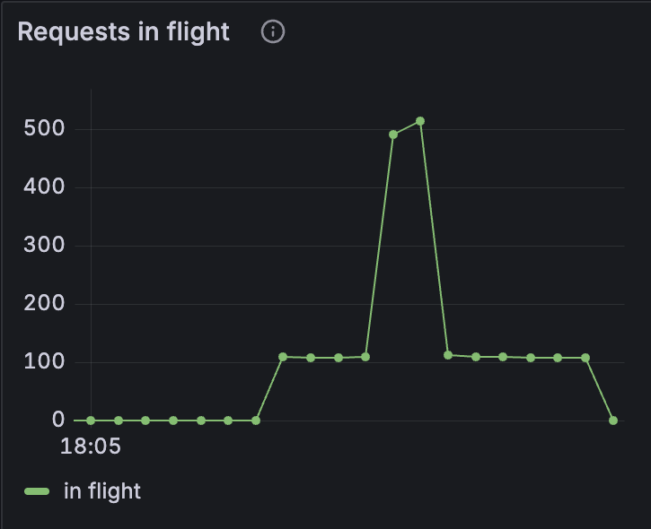

# Decisions

Every design decision in this project: what we chose, what we rejected, why, and what it costs.
Each entry also gives the **production term** for the idea (the words to use in interviews) and, where it really helps, something to read.

**How to read an entry:** *I chose X over Y because Z. The cost is W, and we reduce it by V.* That one sentence is the interview answer.

Decided 2026-11-02 → 2026-11-03. The newest decisions are at the bottom of each section.

---

## A. Architecture (from the system design)

### A1. Stateless gateway copies; shared state in Redis
- **Decision:** run several identical gateway copies behind a load balancer. Nothing shared lives in a copy's memory. The cache and rate-limit counters live in Redis.
- **Alternatives:** keep state inside each copy (for example, a Python `dict` as the cache).
- **Why:** with in-memory state, a request that lands on copy #3 can't see what copy #1 cached, and a restart or deploy wipes it.
- **Pros:** add copies to handle more traffic; any copy can serve any request; deploys don't lose data.
- **Cons:** every request now depends on a network call to Redis. *(Open: what happens when Redis is down? See A6.)*
- **Production terms:** *stateless service*, *horizontal scaling*, *externalized state*.
- **Read:** Kleppmann, *Designing Data-Intensive Applications*, ch. 1.

### A2. Redis on its own machine, in the same data center
- **Decision:** Redis is a separate server, not on a gateway machine, but in the same data center or region.
- **Alternatives:** Redis on one of the gateway machines; Redis in another region.
- **Why:** with 3 gateway copies, putting Redis on one of them makes that machine special, and its failure takes the cache down too. In another region, each call is about 80 ms, which alone breaks our 20 ms overhead budget. In the same data center it's about 0.5 ms.
- **Production terms:** *network latency budget*, *single point of failure (SPOF)*, *managed service* (for example, AWS ElastiCache).
- **Read:** "Latency Numbers Every Programmer Should Know" (a one-page chart).

### A3. Pipeline order: auth → rate limit → cache → router → provider
- **Decision:** authenticate first, then rate-limit, then check the cache, and only then route to a provider.
- **Alternatives:** cache before auth (skip auth on cache hits).
- **Why:** a cache before auth would hand cached answers to anyone, even without a key. The rate limiter needs to know the team, so it has to come after auth.
- **Production terms:** *request pipeline*, *middleware chain*, *authentication (who are you) vs authorization (what are you allowed to do)*.

### A4. Rate limiter before the cache
- **Decision:** rate limits apply even to requests that would be cache hits.
- **Alternatives:** rate-limit only after a cache miss, because a cache hit costs almost nothing.
- **Why:** a broken script sending the same cached request 50,000 times a second still overloads the gateway and Redis, even though the LLM is never called.
- **Cons:** a team's cache hits use up its request limit. *(Open: two limits? A cheap flood limit early, and a token/budget limit just before the LLM call.)*
- **Production terms:** *noisy neighbor* (one tenant hurting the others; our "broken script" problem), *load shedding*, *multi-tenancy*.
- **Read:** Stripe Engineering blog, "Scaling your API with rate limiters."

### A5. Async I/O
- **Decision:** async Python (FastAPI with `async`/`await`), not one thread per request.
- **Why:** from Little's Law, 300 RPS × 5 s per LLM call means **about 1,500 requests in flight** at peak, and 6,000+ if a provider slows to 20 s. The gateway mostly *waits*. Async lets one process wait on thousands of requests cheaply.
- **Production terms:** *Little's Law* (L = λ × W), *I/O-bound vs CPU-bound*, *event loop*, *concurrency vs parallelism*.
- **Read:** Wikipedia, "Little's law" (just the intro and the examples).

### A6. *(Open)* What happens when Redis is down?
- To decide in Phase 3: **fail open** (skip the cache or limit and keep serving) or **fail closed** (reject requests), decided separately for the cache, rate limits, and budgets.

---

## B. Cache (designed; built in Phase 4)

### B1. Cache-aside
- **Decision:** on a request, `GET` the key. On a hit, return it. On a miss (`nil`), call the LLM, `SET` the answer, then return it.
- **Alternatives:** write-through (the cache sits in front of the source and writes through it). That doesn't fit, because an LLM isn't a database we write to.
- **Note:** the order of saving and sending doesn't prevent a *cache stampede*. Identical requests that arrive during the first LLM call all miss either way. *(Open: request coalescing.)*
- **Production terms:** *cache-aside / lazy loading*, *cache hit / miss*, *cache stampede / thundering herd*, *request coalescing / single-flight*.
- **Read:** AWS Builders' Library, "Caching challenges and strategies."

### B2. Cache key: `cache:<tenant>:<sha256(model + temperature + max_tokens + messages)>`
- **Decision:** everything that changes the answer goes into the key. It's hashed for a fixed size, with the tenant kept readable as a prefix.
- **Why each part:**
  - **tenant:** B must never get A's answer.
  - **model:** a strong-model request must not get the cheap model's answer.
  - **temperature, max_tokens:** both change the output.
  - **all messages:** the system prompt changes the answer ("pirate" vs "lawyer").
  - **hash:** a 300-page prompt would otherwise be the key, and SHA-256 is always 64 characters.
  - **readable tenant prefix:** lets us find or delete all of one tenant's keys.
- **Production terms:** *tenant isolation*, *cache key normalization*, *key namespacing*, *cryptographic hash*.

### B3. Entries expire with a TTL
- **Decision:** every entry gets a TTL (`SET key value EX <seconds>`).
- **Why:** it handles both stale answers (the refund policy changed) and a cache that fills up forever.
- **Tradeoff:** a short TTL means fresher answers but more misses, which costs money. A long TTL means more hits but stale answers.
- *(Open: a per-tenant TTL? Event-based invalidation? Who tells the gateway that data changed?)*
- **Production terms:** *TTL*, *cache invalidation* (time-based vs event-based), *staleness*, *eviction policy (LRU)*.

---

## C. Foundation (Phase 0)

### C1. Python + FastAPI + httpx + Pydantic
- **Why:** the standard production stack for async Python APIs. Pydantic validates requests, and httpx is an async HTTP client with connection pooling.
- **Alternatives:** Go (faster, but less familiar, and the AI/ML ecosystem is Python); Flask (not async-first).

### C2. One shared HTTP client for the whole app
- **Decision:** create one `httpx.AsyncClient` at startup (`lifespan`) and reuse it for every request.
- **Alternatives:** create a new client per request.
- **Why:** a new client per request opens a new TCP and TLS connection to the provider every time, which is slow and exhausts sockets. A shared client keeps a pool of connections open.
- **Production terms:** *connection pooling*, *keep-alive*, *TLS handshake cost*, *file descriptor limits*.
- **Read:** httpx docs, "Resource Limits" and "Timeouts."

### C3. Secrets from the environment (`.env` in development); fail fast at startup
- **Decision:** API keys come from environment variables, never from code. The config file holds only the *name* of the env var. A missing key stops startup with a clear error.
- **Why:** code ends up on GitHub. Failing at startup means a broken deploy is caught at deploy time, not on the first request at 3 a.m.
- **Production terms:** *12-factor config*, *secrets management*, *fail fast*.
- **Read:** 12factor.net, "III. Config."

### C4. Validate requests before calling the provider
- **Decision:** Pydantic checks the request shape. A missing `model` gets a 422 immediately, and the provider is never called.
- **Why:** it's free and takes about 1 ms instead of a paid round trip. And a 4xx tells the client to fix their request, not to retry.
- **Production terms:** *input validation at the edge*, *fail fast*.

### C5. Forward fields we don't model
- **Decision:** `extra="allow"`, so `top_p`, `tools`, `response_format`, and other fields reach the provider.
- **Why:** Pydantic silently **drops** unknown fields by default, which would quietly break the "drop-in replacement" promise.
- **Production terms:** *API compatibility*, *drop-in replacement*, *forward compatibility*.

---

## D. Streaming (Phase 1)

### D1. Pass the SSE stream through unchanged
- **Decision:** forward every line the moment it arrives. The gateway only watches (TTFT and usage) and changes nothing.
- **Why:** users see the first words in about 1 s instead of waiting for the whole answer.
- **Production terms:** *Server-Sent Events (SSE)*, *time to first token (TTFT)*, *streaming proxy*.
- **Read:** MDN, "Using server-sent events."

### D2. The gateway always asks for usage in streams
- **Decision:** set `stream_options.include_usage = true` on every streamed request.
- **Why:** OpenAI only sends token usage at the end of a stream if asked. Without it, cost tracking, budgets, and token limits can't see streamed requests.
- **Production terms:** *usage metering*, *cost attribution*.

### D3. Usage logging always runs (`finally`)
- **Decision:** the code that records usage runs in `finally:`, so it runs even when the client disconnects.
- **Why:** we measured that **1 in 10 streams lost its usage** when the client closed the connection. That's lost cost data.
- **Cons:** if the client leaves *before* the provider sends `usage`, we still don't know the tokens, so we log `usage=None`. *(Open: estimate them; decide with budgets.)*

### D4. Mid-stream failure: send an error event, don't regenerate
- **Decision:** if the provider dies after chunks were sent, send `data: {"error": ...}` without `[DONE]`. The OpenAI SDK raises `APIError`.
- **Alternatives:** regenerate with another provider and continue the stream.
- **Why:** the 200 and part of the answer are already sent, and bytes can't be unsent. A regenerated answer gets **glued on** ("…within 30 Thanks for asking!…") because the OpenAI protocol has no "discard what you got" message. The gateway must not invent behavior the protocol doesn't have. The client knows its own context (show a "Regenerate" button, or retry a job).
- **Production terms:** *response commit point*, *protocol compatibility*, *partial failure*.

### D5. Read ahead: commit only after the first chunk
- **Decision:** for streams, wait for the provider's **first chunk** before sending 200 to the client.
- **Alternatives:** commit as soon as the provider sends its headers.
- **Why:** fallback is only possible before the first byte reaches the client. A provider that sends headers and then goes silent would otherwise leave us stuck.
- **Production terms:** *commit point*, *buffering / read-ahead*.

---

## E. Routing (Phase 2a)

### E1. Fallback chains live in a central config owned by the platform team
- **Decision:** `config.yaml` maps each model name a client can request to an ordered list of `{provider, model}` targets.
- **Alternatives:**
  - per-request fallback lists, where the client sends the list (OpenRouter's `models` parameter);
  - a config sent with each request (Portkey's configs).
- **Why:** 20 internal teams and leadership's cost goals call for central governance, and client code stays one line.
- **Cons:** a team that needs a custom chain has to ask the platform team. A per-request override could be added later.
- **Production terms:** *model routing*, *routing table*, *governance*, *control plane vs data plane*.
- **Read:** the LiteLLM docs on proxy config (`model_list`) and on router fallbacks.

### E2. Clients may send a vendor name **or** a tier name
- **Decision:** both `gpt-4o-mini` and `fast` / `strong` are valid; the config decides the real model.
- **Why:** vendor names keep existing code working (teams change only `base_url`). Tiers let teams say what they need without picking a vendor, and let us swap vendors later.
- **Cons:** during a fallback, a request for `gpt-4o-mini` may be answered by Llama. **Reduced by** always reporting the real provider (`x-gateway-provider`) and model (`model` in the response).
- **Production terms:** *model aliasing*, *model groups*, *vendor lock-in*.

### E3. An unknown model gets a 404 `model_not_found`
- **Decision:** a model name that isn't in the config is rejected without calling any provider.
- **Why:** the platform controls which models teams can use. It's also the same error OpenAI returns, so client code handles it.
- **Production terms:** *allowlist*, *authorization*.

---

## F. Failure handling (Phase 2b)

**The core rule: is it the request's fault or the provider's?** Another provider can't fix a broken request, but it can answer when one provider is in trouble.

### F1. Request errors (400, etc.) are returned as-is: no retry, no fallback
- **Alternatives:** retry (the same input gives the same error); fall back (a lenient provider might accept it, but that **hides the client's bug**).
- **Later (v2):** some 400s are *model limits*, not client mistakes: context window too small, or a content-policy block. LiteLLM has `context_window_fallbacks` and `content_policy_fallbacks` for these.
- **Production terms:** *4xx = client error, 5xx = server error*, *fail fast*.

### F2. Fallback is on by default; clients can opt out
- **Decision:** `x-gateway-fallback: off` disables it for one request.
- **Alternatives:** opt-in (off by default; the user's original idea); always on, with no flag.
- **Why:** **the default decides what happens to everyone who doesn't read the docs.** With opt-in, the support bot is down again in the next outage. Teams that need an exact model (evals) can opt out.
- **Industry:** OpenRouter falls back by default (`allow_fallbacks: false` turns it off). LiteLLM applies configured fallbacks automatically.
- **Production terms:** *failover*, *graceful degradation*, *secure / safe defaults*, *opt-in vs opt-out*.

### F3. An upstream 401/403 is *our* problem: fall back, log at ERROR, and return 502 if nothing is left
- **Alternatives:** pass the 401 through (the client then debugs their own valid key for hours).
- **Why:** teams never send provider keys. The gateway uses **one shared OpenAI key**, so a 401 means *our* key is broken, for every team.
- **Note:** in a **BYOK** design (each user sends their own provider key), a 401 would be that user's fault and should be passed through.
- **Production terms:** *502 Bad Gateway* ("something behind the gateway failed"), *BYOK (bring your own key)*.

### F4. 429: fall back immediately; return 503 with `Retry-After` if nothing is left
- **Alternatives:** wait and retry the same provider (LiteLLM does this, because it often has several deployments of one model).
- **Why:** the 429 is for our **shared** account. Retrying in lockstep across all teams hammers the provider again, and falling back takes load off it.
- **Production terms:** *retry storm*, *backpressure*, *`Retry-After` header*, *503 Service Unavailable*.

### F5. 5xx and connect errors: fall back immediately; on the last option, retry **once** with jitter, then 502
- **Alternatives:** always retry first (slow during real outages); never retry (gives up on one-second glitches when there's no alternative).
- **Why:** fall back fast when an alternative exists. Retry only when nothing else is left, after a random 100–300 ms wait so failed requests don't all retry at the same instant.
- **Production terms:** *exponential backoff with jitter*, *retry budget*, *transient failure*.
- **Read:** AWS Builders' Library, "Timeouts, retries, and backoff with jitter"; Marc Brooker, "Exponential Backoff and Jitter" (AWS Architecture Blog).

### F6. Read timeouts are never retried; 504 if nothing is left
- **Why:** the provider *received* the request and may still be working on it, and billing us. Retrying a **slow** provider piles more requests onto it (a cascading failure). A connect timeout is different: the request was never sent, so it's safe to retry.
- **Production terms:** *idempotency* (is it safe to do twice?), *cascading failure*, *504 Gateway Timeout*.
- **Read:** Google SRE Book, "Addressing Cascading Failures" (free online).

### F7. Timeout values
| Timeout | Value | Why |
|---|---|---|
| Connect | 3 s | Reaching a server takes milliseconds |
| Stream: first chunk | 10 s | Normally about 1 s, and until then we can still fall back |
| Stream: gap between chunks | 30 s | A long silence means it's stuck |
| Non-stream: whole answer | 60 s | Nothing arrives until the end, so slow and long look the same. That's the cost of not streaming. |
- **Production terms:** *connect / read / total timeouts*, *time to first byte (TTFB)*, *deadline*.

---

## G. Circuit breaker (Phase 2c)

The problem: during a full outage, every request still tries the dead provider first and waits up to 3–60 s before falling back. At 300 RPS that means thousands of requests waiting on a provider we already know is dead.

### G1. What counts as a failure: anything that triggers a fallback
- **Decision:** 5xx, connect errors, timeouts, **401, and 429** all count. Request errors (400) never count.
- **Alternatives:** count only "really down" errors (5xx, connect, timeout).
- **Why:** what matters is whether **we** can use the provider, not whether its servers are technically up. And one buggy team sending bad requests must never cut a provider off for all 20 teams.
- **Industry:** LiteLLM puts a deployment into *cooldown* after repeated failures, including 429s.

### G2. Trip after 5 consecutive failures
- **Alternatives:** a failure rate in a time window (for example, ≥50% of the last 30 s, with at least 20 requests).
- **Why:** it's simple (one counter) and detects a full outage in about 17 ms at 300 RPS. A partial outage won't trip it, but each failed request already falls back (F2–F6), so users still get answers.
- **Industry:** Envoy's outlier detection defaults to 5 consecutive errors. resilience4j uses failure-rate windows.
- **v2:** move to a failure-rate window if partial outages start hurting latency.

### G3. Recovery: a 30 s cooldown, then one trial request; everyone else keeps falling back
- **Alternatives:** background health checks (extra moving parts, and a ping can succeed while chat completions are broken).
- **Why:** it tests the real thing, and if the trial fails, that user still gets an answer through fallback. **Only one trial at a time**, because 300 simultaneous trials would knock a recovering provider straight back down.
- **The trial can't get stuck:** a hung trial ends at the 2b timeouts and counts as a failure.
- **v2:** a growing cooldown (30 s → 60 s → 120 s) for a provider that keeps failing its trials.
- **Production terms:** *circuit breaker states: closed / open / half-open*, *cooldown*, *probe / trial request*.

### G4. Breaker state lives in each gateway copy's memory
- **Alternatives:** share the state in Redis.
- **Why:** with 3 copies, each one learns separately, so 15 wasted requests instead of 5. That's about 0.05 s of traffic at 300 RPS, and each of those requests still falls back. Sharing the state would add a Redis call to every request **and** make Redis a new way for the breaker itself to fail.
- **Industry:** Envoy's outlier detection is per proxy instance. resilience4j and Polly keep state in memory by default.
- **Interview line:** *"I deliberately didn't share breaker state, because the coordination cost more than the inconsistency."*
- **Read:** Martin Fowler, "CircuitBreaker" (martinfowler.com/bliki/CircuitBreaker.html); Michael Nygard, *Release It!*, the book that popularized the pattern.

### G5. One breaker per provider + model, not per provider
- **Alternatives:** one breaker per provider.
- **Why:** providers often have trouble with one model at a time. Per provider, a broken `gpt-4o` would also cut off a healthy `gpt-4o-mini`.
- **Cons:** a full provider outage needs 5 failures *per model* before each breaker trips. That's a few more wasted requests, and each still falls back.
- **Industry:** LiteLLM cools down per *deployment* (one model at one provider).
- **Production terms:** *failure domain*, *blast radius*, *deployment*.

### G6. Implementation details that came out of building it
- **When skipped, return `503` with `Retry-After`** set to the seconds left until the next trial, so clients know when to come back. We skipped the provider ourselves, so this is "temporarily unavailable" (503), not "bad gateway" (502).
- **Any real answer counts as success, even a 400.** It proves the provider is up and responding.
- **Late results are ignored.** A slow request that started before the trip and finishes afterward can't close the breaker. Only the trial decides.
- **An abandoned trial frees its slot.** If the trial request is cancelled (the client disconnects), the slot is released. Otherwise the breaker would be stuck half-open forever.
- **No locks:** one asyncio event loop, and the breaker methods never `await`, so requests can't interleave inside them.
- *(Open)* **A provider dying mid-stream doesn't count as a breaker failure** (the stream already succeeded at its first chunk). Count it later if it turns out to happen often.
- **Measured:** with a broken OpenAI key and fallback off, requests 1–5 took **0.3–0.75 s** each to fail at OpenAI. Requests 6–7 failed in **~1.3 ms**, because the breaker skipped OpenAI entirely.

## H. Metrics (Phase 2d)

### H1. Two dashboards: on-call health vs cost/usage
- **Decision:**
  - **On-call dashboard, top row:** traffic (RPS), error rate (5xx as the client sees it), latency (p95 overall, and TTFT for streams). This is the **RED method**.
  - **On-call dashboard, second row (gateway-specific):** fallback rate, breaker state per deployment, requests in flight (saturation).
  - **Cost/usage dashboard:** tokens and $ per model, and per team once Phase 3 adds team keys.
- **Alternatives:** one dashboard with everything; or only latency, cost, and errors (the first pick).
- **Why:**
  - Cost matters a lot (the 30% goal is worth about $400k a month), but it changes slowly. It's read daily or weekly by the platform team and finance, not at 3 a.m. It's a **business metric**, not an **operational** one.
  - **Traffic is required:** if no requests reach the gateway, errors read 0% and latency looks fine. Only RPS dropping to 0 shows it. It's also what makes an error count meaningful.
  - **Gateway-specific metrics catch hidden degradation:** when OpenAI is down but fallback covers it, the client error rate stays at 0%. Only the fallback-rate and breaker graphs show that every team is running on the backup model.
- **Cons:** two dashboards to maintain.
- **Production terms:** *RED method* (Rate, Errors, Duration), *Google's four golden signals* (latency, traffic, errors, saturation), *operational vs business metrics*, *SLI* (the measured number, e.g. % of non-5xx requests), *SLO* (the target, e.g. 99.9%), *degraded mode*.
- **Read (only if needed):** Google SRE book, chapter 6 "Monitoring Distributed Systems" (sre.google/sre-book/monitoring-distributed-systems/); Tom Wilkie, "The RED Method" (Grafana blog).

### H2. Tool: Prometheus + Grafana
- **Decision:** the gateway exposes `GET /metrics`; Prometheus scrapes it every 15 s; Grafana draws the dashboards. Both run locally with Docker Compose.
- **Alternatives:** OpenTelemetry (push to a collector; also does tracing); Datadog / New Relic (paid SaaS agents).
- **Why:** the open-source standard (LiteLLM, Envoy, and Kubernetes all expose `/metrics`), free, and anyone who clones the repo can run the same dashboard.
- **Cons:** two more containers. Docker is needed now instead of in Phase 3 (Redis needs it anyway).
- **Later:** add OpenTelemetry if we want **traces** that follow one request through every step.
- **Production terms:** *pull model / scraping*, *scrape interval*, *exposition format*, *time-series database (TSDB)*, *observability: metrics, logs, traces (the three pillars)*.

### H3. Which metrics, their types, and their labels
| Metric | Type | Labels | Answers |
|---|---|---|---|
| `gateway_requests_total` | counter | model, status | traffic (RPS) and error rate |
| `gateway_request_duration_seconds` | histogram | model | p95 latency, **including the whole stream** |
| `gateway_requests_in_flight` | gauge | none | saturation (Little's Law, A-section estimates) |
| `gateway_upstream_attempts_total` | counter | deployment, outcome | which provider is failing and how (`ok`, `server`, `circuit_open`, `mid_stream`...) |
| `gateway_fallbacks_total` | counter | model | degraded mode that clients can't see |
| `gateway_breaker_state` | gauge, one-hot | deployment, state | which breakers are open right now |
| `gateway_ttft_seconds` | histogram | deployment | streaming responsiveness |
| `gateway_tokens_total` | counter | deployment, kind | usage, and cost once we add prices |
- **Types:** counter = only goes up (Prometheus computes the rate); gauge = goes up and down; histogram = buckets, for percentiles.
- **Breaker state is one-hot** (one series per state, set to 1 or 0) instead of label-encoded 0/1/2, so "how many breakers are open" is a plain `sum`. This is Prometheus's *state set* pattern.
- **Labels only with a small, fixed set of values.** Never `prompt` or `request_id`: each unique value is a new time series kept in memory (*cardinality explosion*), and `prompt` would also break the no-raw-prompts rule. Model names the client sends that aren't configured are labelled `unknown`, so a client can't create series. `team` comes in Phase 3 (about 20 values: fine).
- **Two model labels:** `model` is what the client asked for (`fast`); `deployment` is what we actually called (`openai/gpt-4o-mini`), the same name as the breakers.
- **Buckets go up to 60 s.** The library defaults stop at 10 s, which suits web pages but not LLM calls.
- **RED metrics come from an ASGI middleware**, because only something wrapping the whole response sees a stream's real end. The endpoint passes the model label through `request.state`.
- **A provider dying mid-stream** is now visible as `outcome="mid_stream"` (the open item in G6). It still doesn't trip the breaker.
- **One process per container** for now. With several uvicorn workers in one container, each worker has its own counters, and you'd need the client library's *multiprocess mode*.
- **Not yet:** $ cost (needs prices in the config) and gateway overhead (the 20 ms target; it's measured in Phase 6 with a mock provider).
- **Production terms:** *cardinality*, *time series*, *bucket*, *state set*, *instrumentation*, *middleware*.
- **Read (only if needed):** Prometheus docs, "Metric types" and "Instrumentation: Use labels" (prometheus.io/docs/practices/instrumentation/).

### H4. Local monitoring stack: Docker Compose, dashboards as code
- **Decision:** `docker-compose.yml` runs Prometheus (scrapes `host.docker.internal:8000` every 15 s) and Grafana. Grafana's data source and both dashboards are **provisioned** from files in `monitoring/`, so `docker compose up -d` gives anyone the same dashboards with no clicking.
- **The gateway stays on the host for now** (fast edit-restart loop). It moves into Compose in Phase 3, alongside Redis.
- **Alternatives:** build dashboards by clicking in Grafana (lost when the container is recreated, and can't be reviewed in a PR); Grafana Cloud (hosted, but needs an account).
- **Queries worth knowing:** `rate(counter[1m])` turns a counter into per-second; `histogram_quantile(0.95, sum by (le) (rate(..._bucket[5m])))` gives p95; `increase(counter[1h])` gives a total over a window.
- **Prometheus history lives in a named volume** (`prometheus-data`), so it survives `docker compose down`; `down -v` wipes it. Containers are disposable: anything that must survive lives in a mounted file or a volume. Production adds a *retention period* (Prometheus default: 15 days).
- **Images pinned:** `prom/prometheus:v3.5.0`, `grafana/grafana:12.1.0`. Anonymous Viewer access is on for local use only.
- **Production terms:** *provisioning*, *dashboards as code*, *PromQL*, *service discovery* (replaces our static target in Kubernetes).

### H5. Alert on TTFT and TPOT, not just total latency
- **Decision:** add `gateway_tpot_seconds{deployment}` (histogram, buckets 5 ms–0.5 s per token), computed at the end of a stream as `(total − TTFT) ÷ (completion tokens − 1)`. Alongside TTFT, it's an on-call panel.
- **Why:** an LLM writes output **one token at a time**, so total latency depends mostly on **answer length**. A p95 jump from 2 s to 8 s may just mean one team started asking for essays. TTFT and TPOT don't depend on length, so a rise in either means the provider really is slow. (Input tokens matter much less: the model reads them all at once, which is called *prefill*.)
- **Cons:** streams only (a non-streamed answer arrives in one piece, so there's nothing to time per token); no TPOT if the client leaves before the usage chunk.
- **Bucket resolution:** histogram percentiles are estimates *inside* a bucket (the measured p50 1.29 s and p95 1.93 s were both somewhere in the 1–2 s bucket). Add buckets where the distinction matters.
- **Industry:** vLLM, TGI, and LLM benchmarking tools report TTFT and TPOT (also called *inter-token latency*, ITL) as their main latency numbers.
- **Production terms:** *TTFT*, *TPOT / ITL*, *prefill vs decode*, *tokens per second*, *bucket resolution*.

## I. More providers: Anthropic adapter, Groq, Ollama

### I1. Providers have a `type`; only Anthropic needs translation
- **Decision:** each provider in `config.yaml` has `type: openai` (the default) or `type: anthropic`. Anything that speaks OpenAI's API (Groq, Ollama, vLLM, Together, DeepSeek...) needs only config. Anthropic gets an adapter (`anthropic_adapter.py`) that translates the request on the way out and the response or stream on the way back.
- **Why:** routing, fallback, the breaker and metrics stay unchanged; only the "talk to this provider" step knows about Anthropic. This is the *adapter pattern*.
- **Alternatives:** Anthropic's own OpenAI-compatible endpoint (no code, but missing features and meant mainly for testing); Anthropic's Python SDK (a second HTTP stack with its own pool, timeouts and retries, which would bypass the timeout and retry policy in F).
- **Industry:** LiteLLM is essentially a large collection of these adapters, built on plain httpx.

### I2. Request mapping
- `system`/`developer` messages move to Anthropic's top-level `system` field. `stop` becomes `stop_sequences`, `user` becomes `metadata.user_id`, and `max_completion_tokens`/`max_tokens` become `max_tokens`.
- **`max_tokens` defaults to 16000** when the client leaves it out (Anthropic requires it). Thinking is on by default on current Claude models and its tokens count toward the cap, so a small default can cut the answer off. The cap doesn't change cost; you pay for tokens generated.
- **`temperature` and `top_p` are dropped**, and the response says so in `x-gateway-dropped-params`. Current Claude models only accept the default sampling, and API version `2026-10-21` rejects the fields outright. *(Changed from the first proposal, which was to cap temperature at 1: that would still get a 400.)* The cost is that a client asking for `temperature: 0` gets default sampling from Claude.
- **API version:** `anthropic-version: 2026-10-21`.

### I3. Features Anthropic can't handle: skip the target, don't blame anyone
- **Decision:** a request with fields the adapter doesn't translate (`tools`, `n` > 1, `logprobs`, `response_format`...) skips the Anthropic target with failure kind `unsupported` and moves to the next one. It **never counts against the breaker** (the provider was never called) and is never retried. If every target was unsupported, the client gets a 400 naming the field. If any target failed for real, that failure decides the status (a 503 from OpenAI is still a 502, not the client's fault).
- **Alternatives:** silently drop unknown fields (LiteLLM's `drop_params`; a request with `tools` would get an answer that ignores them); always 400 (wrong when another target could handle it).
- **v2:** translate tool calling.

### I4. Errors
- 401/403 → `auth`, 429 → `rate_limit`, 500 and **529 `overloaded_error`** → `server`: the same table as F. Anthropic's 4xx error bodies are rewritten into OpenAI's shape (`{"error": {"message", "type", "code"}}`) so clients only parse one format.

### I5. Streaming: translate events, commit at the first content block
- Anthropic's events (`message_start`, `content_block_start/delta/stop`, `message_delta`, `message_stop`, `ping`, `error`) become OpenAI chunks. Thinking blocks are left out. Input tokens (from `message_start`, including cache reads and writes) and output tokens (from `message_delta`) are combined into the final `usage` chunk, so metrics and cost tracking work unchanged.
- **Commit point:** nothing reaches the client until the model starts its first content block. Anthropic can send `message_start` and then report `overloaded_error` inside the 200 stream; because we haven't committed, that still falls back. *Production term:* *in-band errors*. TrueFoundry calls the same idea a "first-chunk gate".
- **Why the first content block, not the first text:** with thinking on, text can start long after our 10 s first-chunk timeout, which would cause needless fallbacks that cost money.
- **After the commit point** an `error` event, or a stream that ends without `message_stop`, sends our usual error event with no `[DONE]` (D-section).

### I6. Groq and Ollama: config only
- Groq (`https://api.groq.com/openai/v1`, `openai/gpt-oss-20b` / `openai/gpt-oss-120b`) and Ollama need no code. Fallback chains pair by tier: `gpt-4o-mini` → Groq gpt-oss-20b → Claude Haiku 5.5 → local Llama; `gpt-4o` → Claude Sonnet 5.5 → Groq gpt-oss-120b.
- **Groq is verified for real** (see I8). Anthropic still has no key, and Ollama isn't installed. Their config entries are commented out because the gateway refuses to start when a configured key is missing (C-section). Tests use a fake Anthropic built from Anthropic's documented formats.
- **Read (only if needed):** Anthropic, "Streaming Messages" (platform.claude.com/docs/en/build-with-claude/streaming); "Migrating to API version 2026-10-21" (platform.claude.com/docs/en/api/migration-2026-10-21).

### I7. Where the adapter sits, and why that matters
- **Position:** at the very bottom of the call path, inside `upstream.call_target()`, the step that talks to one provider. The fallback loop, retries, the breaker and metrics sit above it and only ever see OpenAI's format, so adding Anthropic changed none of them.
- **Four functions, one per direction:** `to_anthropic()` (request out), `from_anthropic()` (response back), `error_to_openai()` (error bodies back), `translate_stream()` (stream back).
- **Streaming is a pipeline of async generators:** raw httpx lines → `translate_stream()` → read-ahead to the commit point → `relay_stream()` (TTFT, TPOT, usage) → client. Each stage only knows about the stage before it.
- **What can't be translated is said out loud:** `Unsupported` for features Claude lacks, and `x-gateway-dropped-params` for fields we removed. Nothing is changed silently.
- **Learned:** provider quirks show up in places you don't expect. Sampling parameters are now rejected, thinking tokens count toward `max_tokens`, cache tokens are reported separately, and errors can arrive inside a 200 stream. Read the provider's current docs before trusting memory.
- **Production terms:** *adapter pattern*, *schema mapping*, *anti-corruption layer* (a translation boundary that keeps another system's model out of yours), *canonical format*, *stream transformation*, *in-band errors*.
- **Interview line:** *"Provider differences are isolated in adapters at the bottom of the call path. Routing, fallback and circuit breaking only see one canonical format, so adding a provider never touches them."*

## J. Team API keys (Phase 3)

### J1. Keys are generated by the gateway and stored only as SHA-256 hashes
- **Decision:** the gateway generates every key (a prefix plus 32 random characters; teams never choose their own). The database stores only the key's **SHA-256 hash** plus a short visible prefix, so people can tell keys apart. The full key is **shown once**, at creation, and never stored. On each request the gateway hashes whatever key arrives and looks the hash up.
- **Why:** access control on the database is only one layer. Backups, a leaky admin page, or someone running `SELECT *` while sharing their screen can all expose the table. With hashes, a full copy of the table is useless. Sending a stolen hash doesn't work, because the gateway hashes it again and gets a different value. This is *defense in depth*.
- **The hash function isn't a secret, and doesn't need to be.** SHA-256 is a public standard (*Kerckhoffs's principle*: assume the attacker knows how the system works). With the table and the function, an attacker can only guess, and there are about 2^190 possible keys.
- **Fast hash, not bcrypt:** bcrypt and Argon2 are deliberately slow (about 100 ms) because human passwords are guessable (*low entropy*), so slowness makes offline guessing against a stolen table expensive. Random keys aren't guessable, so slowness adds nothing. It would add 100 ms to every request (five times the 20 ms budget) and use about 30 CPU cores at 300 RPS.
- **What hashing doesn't protect:** keys in transit (TLS covers that) and keys inside a compromised gateway (the answer there is revocation, rotation, and never logging keys).
- **Industry:** Stripe, OpenAI and GitHub all hash keys and show them once; that's why their dashboards only show part of each key.
- **Optional extra, not needed for random keys:** HMAC-SHA256 with a secret *pepper* kept outside the database.
- **Production terms:** *hashing*, *defense in depth*, *show-once secrets*, *entropy*, *offline / dictionary attack*, *key derivation function*, *Kerckhoffs's principle*, *data at rest vs in transit*, *revocation*, *rotation*, *threat model*.
- **Prefix: `sbk_`** (switchboard key), e.g. `sbk_8f3kQ9x2Lm7v...`. It's distinctive, so *secret scanning* can match it with few false alarms (OpenAI's `sk-` is shared by many providers). It uses an underscore so a double-click selects the whole key (GitHub switched to `ghp_` for this), and it's short.

### J2. Postgres as the source of truth, an in-process cache for every request
- **Decision:** keys (and later teams and spend) live in **Postgres**. Each gateway copy keeps a **dictionary in its own memory** of recently checked key hashes, with an expiry time. Only a cache miss queries Postgres. Invalid hashes are cached briefly too (*negative caching*), so a flood of made-up keys can't overload the database.
- **Alternatives:** a YAML file (every change needs a restart, and there's nowhere to keep spend); Redis only (fast, but keys and spend are business records that need durable, queryable storage); a Redis cache (a network hop and a new failure mode on every request, for data that changes a few times a week).
- **Why memory and not Redis for the cache:** keys are read 300 times a second and change rarely (a *read-heavy workload*). A memory lookup takes about a microsecond and can't go down. Redis is kept for data that must be shared right away, like rate-limit counters.
- **Cons:** a revoked key keeps working until its cache entry expires on every gateway copy. One more container (Postgres, with a named volume for its data).
- **Industry:** LiteLLM stores its virtual keys in Postgres with a cache in front.
- **Production terms:** *source of truth*, *cache-aside*, *in-process cache*, *negative caching*, *relational database*, *ACID transactions*, *write-ahead log (WAL)*.
- **Cache expiry: 60 s for valid keys, 10 s for invalid ones.** A leaked key takes a person minutes or hours to notice, so 60 extra seconds barely matter, and Postgres stays nearly idle (about 100 keys × 3 gateway copies ÷ 60 s ≈ 5 queries a second, roughly a 98% hit rate). Invalid entries expire faster, so a new key works quickly even if someone tried it just before it was created.
- **No sticky sessions needed:** each gateway copy fills its own cache, so the load balancer can send a request anywhere (round-robin, least connections). A miss just costs about 1 ms, on a pooled connection.

### J3. How the check runs
- **First step of every chat request** (a FastAPI dependency), before the body is validated, so strangers learn nothing about our request format. `/healthz` and `/metrics` stay open. In production, `/metrics` should only be reachable from the internal network.
- **Errors in OpenAI's shape:** a missing key is `401 missing_api_key`, a wrong or revoked one is `401 invalid_api_key`, so the OpenAI SDK raises its usual `AuthenticationError`.
- **Fail closed when Postgres is down:** a key that isn't cached gets `503 auth_unavailable`; cached keys keep working until their entry expires. Failing open would let anyone in during an outage. *(This settles the auth part of the open "fail-open vs fail-closed" question.)* **v2:** keep serving recently valid keys past their expiry while Postgres is down (*stale-if-error*).
- **Cheap checks first:** anything that isn't `sbk_` plus 32 characters gets a 401 without touching the database, and the invalid-key cache is capped at 10,000 entries, so random keys can't fill the gateway's memory.
- **Revoking is a soft delete:** `UPDATE api_keys SET revoked_at = now() WHERE id = ...`. The dashboard (for now, `scripts/keys.py`) works with key IDs and visible prefixes, never full keys. Rows are kept, because spend history will point at them.
- **Schema:** created by `scripts/setup_db.py` with `CREATE TABLE IF NOT EXISTS`, run as the database owner (M3); the gateway only checks the tables exist. **v2:** a migration tool (Alembic) once the schema starts changing.
- **Driver:** asyncpg with a pool of 1-5 connections and a 2 s query timeout. Opening a new connection per query would cost 5-20 ms.
- **Tests** use an in-memory fake key store, so they need no Postgres. The real path was checked by hand against Postgres in Docker.
- **Production terms:** *fail closed*, *stale-if-error*, *soft delete*, *schema migration*, *connection pool*, *FastAPI dependency*.

### I8. First real fallback, and what it taught us
- **Test:** a gateway copy with a deliberately broken OpenAI key, sending real requests. Requests 1–5: OpenAI 401 → Groq 200 (`x-gateway-attempts: openai:auth`). Request 6: OpenAI skipped by its breaker (`openai:circuit_open`). Streaming fell back too, with usage reported at the end.
- **Bug found: a provider's 404 went back to the client.** Groq had retired the Llama model IDs in our config (I wrote them from memory). The client asked for `gpt-4o-mini`, a valid gateway model, so the wrong model ID is our fault. **Decision:** a provider 404 is now failure kind `config`: fall back, log at ERROR (like `auth`), count against the breaker, and return 502 if nothing is left.
- **Lesson:** check model IDs against the provider's live `/models` list, not memory. **v2:** check every configured model ID at startup.
- **Reasoning models count reasoning in `max_tokens`:** for "Say hi", Groq's gpt-oss-20b used 98 of 111 output tokens on reasoning. A small `max_tokens` can return an empty answer. The same applies to Claude's thinking (I2).
- **Free-tier latency is mostly queueing:** Groq reported 0.7–1.1 s of `queue_time` and about 0.1 s of generation.

## K. Rate limits (Phase 3b)

### K1. Counters live in Redis, not in each gateway copy
- **Problem:** with 3 gateway copies each counting in its own memory, a "100 per minute" limit really allows about 300. The real number changes whenever we add or remove copies, and an uneven load balancer can reject a team on one copy while the others sit idle.
- **Decision:** one shared counter per team in **Redis**. A call takes well under a millisecond on a local network, and Redis runs each command (or Lua script) by itself, so two gateway copies can't both read "99" and both let a request through.
- **Production terms:** *distributed rate limiting*, *shared state*, *atomic operation*, *race condition*.

### K2. Algorithm: token bucket
- **How it works:** each team has a bucket with a **capacity** (the biggest burst allowed) that refills at a steady **rate** (the long-term limit). A request takes coins from the bucket; an empty bucket means `429`. The bucket never fills past its capacity, so an idle team can't save up a huge allowance.
- **No timer:** Redis stores two numbers per team, `tokens` and `last_updated`. The refill is worked out when a request arrives: `tokens = min(capacity, tokens + elapsed × rate)`. The read, refill, and subtract run as one **Lua script**, so it's atomic and one round trip.
- **Alternatives:**
  - *Fixed window* (a counter that resets every minute): simplest, but 100 requests at 14:05:59 plus 100 at 14:06:00 gives 200 in 2 seconds (*boundary burst*).
  - *Sliding window log* (a sorted set of every request's timestamp): exact, but memory and work grow with traffic.
  - *Sliding window counter* (this window's count plus a weighted share of the last one's): close to exact with two counters. Cloudflare uses it. A fine choice, but it has one dial instead of two.
- **Why the bucket:** burst size and steady rate are separate dials; it stores two numbers per team however busy the team is; and a request can take **many coins at once**, which is what limiting LLM tokens needs (K3). OpenAI's and Anthropic's limits behave like this (they refill continuously rather than resetting on the minute), so teams already understand our 429s.
- **Industry:** Stripe (token bucket in Redis), AWS API Gateway (token bucket), Cloudflare (sliding window counter).
- **Production terms:** *token bucket*, *leaky bucket*, *burst capacity*, *refill rate*, *lazy refill*, *Lua scripting in Redis*.

### K3. Limit both requests per minute and tokens per minute
- **Decision:** two buckets per team, **RPM** (each request costs 1) and **TPM** (each request costs its tokens). A request has to pass both.
- **Why both:** they catch different abuse. RPM alone lets one team send a few 100k-token prompts and use up our provider quota. TPM alone lets a team send thousands of tiny requests that load the gateway and hit the provider's own RPM limit. Providers limit both, so we have to as well.
- **The catch with tokens:** when a request arrives we know the prompt, but not how long the answer will be.
- **Options:**
  - *Reserve up front* (prompt + `max_tokens`): this is what OpenAI does. But many clients don't set `max_tokens`, and reasoning models make it large, so teams get throttled for tokens they never used.
  - *Charge afterwards* (check the bucket isn't empty, subtract the real usage when the response ends): exact, but a 200k-token prompt is only noticed after we've paid for it.
  - *Estimate, then settle:* take an estimate of the prompt (about 4 characters per token, no tokenizer needed) before calling the provider, then charge or refund the difference once the provider reports real usage. The bucket can go below zero, and a team in debt waits until it refills.
- **Decision: estimate, then settle.** It costs the same two Redis calls as charging afterwards, rejects a huge prompt before it costs anything, and ends up exact. Many requests in flight at once can still each pass while the bucket is positive. The RPM bucket bounds that.
- **Production terms:** *RPM / TPM*, *reservation and reconciliation*, *estimate-then-settle*, *token debt*.

### K4. Redis down: fail open, onto a smaller limit in each copy
- **Decision:** if Redis can't be reached, each gateway copy switches to a bucket in its own memory, with the team's limit divided by `gateway_copies` (from config.yaml). It logs one ERROR, sets the `gateway_rate_limit_degraded` gauge to 1, and tries Redis again every 5 seconds. Once Redis answers, it logs that and goes back to shared limits.
- **Why not reject everything** (fail closed, like auth in J3): auth answers "is this a real customer?", so letting requests through lets strangers in. Rate limiting answers "is this customer sending too much?", so the worst case is a few minutes of real teams over their share. Rejecting would turn a Redis restart into an outage for every team while the providers, Postgres and the gateway are all fine.
- **Why not unlimited:** the per-copy bucket is the old "each copy counts on its own" problem, but split by the number of copies it's close enough for a few minutes. It reuses the same bucket code.
- **What still protects us during the outage:** auth (only real teams get in), budgets in Postgres (3c), and the providers' own limits, which our fallback already handles.
- **Industry:** Envoy's rate limit filter lets requests through by default when its rate limit service is down (`failure_mode_deny: false`).
- **Interview line:** fail closed on security checks, fail open on protection checks, and make the degraded mode visible.
- **Production terms:** *fail open*, *graceful degradation*, *single point of failure*, *blast radius*.

### K5. How it's built
- **Where it runs:** first thing in the chat endpoint, right after auth and before the model lookup, the cache and the providers.
- **Limits come from `config.yaml`:** a default plus per-team overrides. Each bucket holds one minute's limit, so the burst size equals the per-minute limit. Limits will move to Postgres with budgets if they start changing often.
- **One Lua script checks and takes from both buckets.** A request refused by the tokens bucket doesn't spend a coin from the requests bucket. Lua returns numbers as integers, so the script returns the fractional coin counts as strings.
- **The time comes from the gateway, not Redis,** so the tests can control it. Gateway clocks are kept in sync by NTP to within milliseconds, and the script never lets elapsed time go negative, so a slightly wrong clock just means a slightly early or late refill.
- **Keys expire after 120 s.** An expired bucket is the same as a full one, so idle teams cost no memory.
- **The 429 looks like OpenAI's:** `code: rate_limit_exceeded`, `type: requests | tokens`, a `Retry-After` header, and the `x-ratelimit-limit-*` and `x-ratelimit-remaining-*` headers (also on successful responses). The OpenAI SDK sees the 429 and by default waits and retries twice on its own. A prompt bigger than the whole per-minute limit is told it's "too large", since waiting won't help.
- **429 vs 503:** 429 means *you* are over your limit. 503 means the *providers* are limiting us (F).
- **Settling:** `call_target` calls a callback with the provider's usage report: right away for a normal response, after the last chunk for a stream. The callback starts a small background task that charges the difference.
- **What isn't settled:** a request where every provider failed keeps its estimate charged. So does a stream that broke before its usage report (v2: count the streamed chunks instead).
- **Redis client:** `redis-py` 7 (`redis.asyncio`) with 100 ms timeouts, since a healthy Redis answers in well under a millisecond. It connects lazily, so the gateway starts even if Redis is down.
- **Tests** use `fakeredis`, which runs the real Lua script, plus a test that runs the same steps through the Lua and the Python fallback and checks that they agree.
- **Checked against real Redis:** with a 3 per minute limit, requests 1–3 got 200 and request 4 got 429 with `Retry-After: 15`. After stopping Redis, requests went on working with local limits, the degraded gauge went to 1, and one ERROR was logged. After restarting Redis, the gateway went back to the shared bucket, and the bucket still remembered the usage from before the outage (the named volume kept it).
- **Production terms:** *Lua script*, *atomicity*, *clock skew*, *lazy connection*, *key expiry (TTL)*.

## L. Budgets (Phase 3c)

### L1. A warning amount and a hard stop, as two dollar numbers
- **Decision:** each team has `soft_usd` and `max_usd` per month, in `config.yaml`. Past `soft_usd`: one WARNING log line per month, Prometheus alerts, and requests still work. At `max_usd`: `429` with `code: budget_exceeded` and `type: insufficient_quota` (OpenAI's word for "out of credit"), until the month resets on the 1st at 00:00 UTC.
- **Why both:** a hard stop alone breaks a production service on the 28th. Warnings alone never stop a runaway loop at 2 a.m. The soft amount gives days of notice, and the hard stop caps the damage.
- **Why two numbers, not "budget plus 20%":** "warn at $500, stop at $600" is easier to read than a percentage, and it's how LiteLLM does it (`soft_budget`, `max_budget`).
- **Industry:** LiteLLM (`soft_budget` alerts, `max_budget` rejects, `budget_duration` resets), Portkey (alert threshold by email, then the key stops), OpenRouter (per-key credit limits that reset daily, weekly or monthly at midnight UTC), AWS Budgets (alerts at chosen percentages, actions optional). They all warn first and stop later, and they all reset on a UTC schedule.
- **Production terms:** *soft limit vs hard limit*, *chargeback / showback*, *budget period*.

### L2. What a request costs
- **Prices** live in `config.yaml` as USD per million tokens, the unit providers publish, copied from each provider's pricing page. A configured model without a price stops startup, the same rule as missing API keys. Otherwise its spend would count as $0 and no budget could stop it. (Portkey documents exactly this gap: models without pricing don't count towards budgets.)
- **The formula:** uncached input × input price + cached input × cached price + cache writes × cache-write price + output × output price.
  - Output includes hidden reasoning tokens. Providers bill them, and gpt-oss spent 98 of 111 tokens on them in I8.
  - The model that actually answered sets the price, not the one the client asked for. A fallback to Groq is billed at Groq's price.
- **Money is an integer number of micro-dollars** (1 = $0.000001), never a float. Floats can't hold amounts like $0.0004 exactly, and sums of millions of them drift. "$X per 1M tokens" is exactly "X micro-dollars per token", so the maths is tokens × price, in `Decimal`, rounded once per request. Rounding is at most half a micro-dollar per request, which comes to $0.50 per million requests.
- **The Anthropic adapter now keeps the cache split:** cache reads go in `prompt_tokens_details.cached_tokens` (OpenAI's field), and cache writes in `prompt_tokens_details.cache_creation_tokens`, our own field, since OpenAI has none. Before this, both were added into `prompt_tokens`, which lost the information pricing needs.
- **Known gaps:** Haiku 5.5's higher price for prompts over 100k tokens isn't modelled. Ollama is $0, though its GPU isn't free. We track list prices; committed-use discounts get reconciled against the real invoice by finance.
- **Production terms:** *list price*, *fixed-point money*, *price snapshot*.

### L3. Postgres ledger as the source of truth, Redis as a cache of the total
- **Decision:** one row per request in an append-only `usage_ledger` table: team, key, requested model, deployment that answered, the four token counts, cost in micro-dollars, and whether the cost was estimated. Rows are added, never changed. Each gateway copy buffers rows in memory and writes them with one `COPY` every second.
- **Redis holds each team's total for the month** (`spend:{team}:{YYYY-MM}`), so the check before each request is one `GET`, not a `SUM` over millions of rows.
- **The total is only a cache.** It expires after 5 minutes and is rebuilt with one `SUM` over the ledger (indexed on `team, created_at`). Anything Redis missed, such as an outage or a restart, is corrected within 5 minutes. New spend is added with `INCRBY` only when the total exists (a small Lua script). Otherwise the next check rebuilds it, because creating a fresh total from one request would forget the rest of the month.
- **Why not Redis as the main record, synced to Postgres later:** whatever hasn't synced is lost when Redis dies, and for money that's not acceptable. *Write to the durable store, derive the fast view.*
- **Why not one INSERT per request:** that would actually work at 300 RPS, but batching makes it one round trip per second instead of 300.
- **Why the price is stored on each row:** prices change, and last month's bill must never be recalculated with today's prices.
- **Known, bounded errors:**
  - a gateway copy that crashes loses up to about 1 s of its unwritten rows (a clean shutdown writes them);
  - a rebuilt total misses the rows still in the buffer, about 1 s of traffic, until the next rebuild;
  - a request that starts just under `max_usd` can end above it, by at most one request's cost per request in flight.
- **Production terms:** *append-only ledger*, *event sourcing (lite)*, *derived view*, *write batching*, *cache rebuild*, *source of truth*.

### L4. When things fail
- **Redis down:** the check is skipped (fail open, the same reasoning as K4), and the response has no budget headers instead of made-up numbers. Rows still go to Postgres, so nothing is lost, and the next rebuild catches up.
- **Postgres down:** rows stay in the buffer and are retried every second. The buffer is capped at 100,000 rows, about 5 minutes at 300 RPS; past that the oldest rows are dropped and counted in `gateway_ledger_dropped_rows_total`. Prometheus alerts when more than 1,000 rows are waiting for a minute.
- **A stream cut short before its usage report:** the prompt estimate is charged as input, and the row is marked `estimated = true`.

### L5. Where it runs and what people see
- **Order:** `auth → rate limit → budget → router → provider`. A refused request is counted in `gateway_rate_limited_total{limit="budget"}`.
- **Headers on every response:** `x-gateway-budget-spent-usd`, `-soft-usd` and `-max-usd`. A team's own code can watch them, the same idea as OpenRouter's `limit_remaining`.
- **Metrics:** `gateway_budget_spent_usd{team}`, `gateway_budget_used_ratio{team}` (spend / soft budget), `gateway_ledger_buffered_rows`, and `gateway_ledger_dropped_rows_total`. The cost dashboard shows budget used and spend per team. `team` is a safe label: there are tens of teams, not millions.
- **Alerts** (`monitoring/alerts.yml`): 80% of the soft budget, over the soft budget, and ledger writes failing. In production, Alertmanager would send them to Slack; here they show in Prometheus's Alerts page.
- **Tests** (13 budget tests, 7 pricing tests) use fakeredis and a fake ledger.
- **Checked for real:** Postgres, Redis and OpenAI, with a $0.00001 soft budget and a $0.00003 max. Each "Say hi" cost 4 micro-dollars (9 input + 5 output tokens on gpt-4o-mini). The spend header climbed 0 → 4 → 8 … → 28 µ$, the warning was logged once at 12 µ$, and request 9 got 429 at 32 µ$, overshooting by one request as expected.
- **Bug the real test found:** Postgres's `SUM()` of a `BIGINT` returns a `NUMERIC`, which asyncpg turns into a `Decimal`, and Redis refused to store it. The fake ledger returned an `int`, so the tests couldn't see this. Fail open did its job: all 10 requests still landed in the ledger. The fix is to convert to `int`. **Lesson:** a fake can hide the real driver's types. That's why each phase also gets a real run.

## M. Running everything in Docker (Phase 3d)

### M1. One image, many copies
- **Decision:** a `Dockerfile` builds the gateway image (`python:3.12.16-slim`, 256 MB). Compose runs it with `replicas: 3`. Each container runs **one uvicorn process**; to scale, you run more containers, not more processes per container. That way each copy is one thing to health-check, restart and count, which is how Kubernetes and ECS expect it.
- **Details that matter:**
  - **Dependencies are copied and installed before the code,** so Docker reuses that layer and a code change rebuilds in seconds (*layer caching*).
  - **The process runs as a non-root user** (`app`), so a break-in doesn't get root in the container.
  - **`.dockerignore` keeps `.env` out of the image.** Secrets are passed in at runtime with `env_file`; production would use a secrets manager.
  - **`HEALTHCHECK` calls `/healthz`,** so `docker compose ps` shows `healthy` or `unhealthy`.
  - **`CMD` is in exec form,** so uvicorn is process 1 and gets `docker stop`'s SIGTERM directly. It stops taking new requests and finishes the ones in flight (*graceful shutdown*).
- **Production terms:** *container image*, *immutable artifact*, *horizontal scaling*, *replica*, *graceful shutdown*, *SIGTERM*, *health check*, *layer caching*.

### M2. nginx in front, round-robin
- **Decision:** `nginx:1.30.6-alpine` is the only published port (`:8000`). The gateway copies have no ports of their own and are reachable only on Docker's internal network.
- **How it finds the copies:** Docker's DNS returns one address per copy for the name `gateway`. `server gateway:8000 resolve` re-asks every 5 s, so restarted copies with new IPs are picked up. Requests go round-robin.
- **Settings that matter for an LLM gateway:**
  - **`proxy_buffering off`:** otherwise nginx collects the whole stream and sends it at the end, which defeats streaming.
  - **`proxy_read_timeout 120s`:** longer than the gateway's own 60 s provider timeout, so the gateway, not nginx, decides when to give up.
  - **`keepalive 32`:** reuses connections to the copies.
  - **`/metrics` returns 404 from outside (J3).**
- **When a copy dies:** nginx gets "connection refused" and tries the request on another copy. It does this only when the request never reached a gateway, so a POST is never sent twice.
- **Why nginx:** it's simple and everywhere. Kubernetes would give the same thing with a Service and an Ingress. Envoy or HAProxy would also work.
- **Production terms:** *reverse proxy*, *load balancer*, *round-robin*, *service discovery*, *DNS-based discovery*, *upstream keepalive*.

### M3. Least privilege in Postgres
- **Decision:** two database logins.
  - **`switchboard`**, the owner, is used by `scripts/setup_db.py` and `scripts/keys.py`.
  - **`gateway`** is used by the running copies, and can only do: `SELECT` on `api_keys`; `SELECT, INSERT` on `usage_ledger`; and use the ledger's ID sequence.
- **Why:** this is the fix for the question "if someone can write to the database, what's the point of hashing?" A hacked gateway can't add a key, un-revoke one, change or delete ledger rows, or create tables. We checked: each of those returned `permission denied` as the `gateway` user.
- **Schema setup moved out of gateway startup** into `scripts/setup_db.py`, since `gateway` isn't allowed to create tables. It runs as a one-off `db-setup` container, and the gateway copies wait for it to exit successfully (`service_completed_successfully`). Postgres gets a `pg_isready` health check so setup waits for a database that is actually ready, not just a started container. The gateway checks at startup that its tables exist and refuses to start with a clear message if they don't.
- **The script can run again safely:** `CREATE ... IF NOT EXISTS`, and the role is only created if it's missing. The password is quoted with Postgres's own `format('%L')`, since DDL can't take `$1` parameters.
- **In production:** the owner wouldn't be a superuser, passwords would come from a secrets manager, and the setup step would be a migration tool (Alembic) run by the deploy pipeline.
- **Production terms:** *least privilege*, *GRANT*, *separation of duties*, *migration job*, *init container*.

### M4. Prometheus scrapes each copy, not the load balancer
- **Decision:** `dns_sd_configs` on the name `gateway` gives Prometheus one target per copy. Through the load balancer, each scrape would hit a random copy, and counters would jump between three different values.
- **Dashboards changed for several copies:**
  - most panels already add copies up with `sum`;
  - breakers are per copy (G4), so the panel shows *how many copies* have a breaker open;
  - budget gauges use `max by (team)`, since each copy reports the total as of its own last check;
  - a new panel shows requests per copy.

### M5. Proof with three real copies
All tests used a model name that doesn't exist, so the rate limiter, which runs before the model lookup, counted every request without OpenAI being called.

| Test | Result |
|---|---|
| 150 requests, team limit 60 per minute, 3 copies | **60 allowed, 90 refused.** The load balancer split them 50 / 50 / 50, so separate counters would have let all 150 through (K1). |
| The same with Redis stopped | **60 allowed**: each copy used its share of 20 (K4). All 3 copies showed `degraded = 1`, and each logged one ERROR, not one per request. |
| 400 requests over 13 s, `docker stop` on one copy 5 s in | **400 of 400 succeeded**, the slowest in 51 ms. nginx moved traffic to the other two copies, and the stopped copy finished its in-flight requests before exiting. |
| A real OpenAI request and stream through nginx | Works. The stream arrived chunk by chunk (TTFT 1.44 s, total 2.05 s), so buffering is really off. |

**Still to do:** Ollama's `base_url` is `localhost:11434`, which inside a container means the container itself. When Ollama is installed, it becomes `host.docker.internal:11434`.

## N. Exact response cache (Phase 4a)

### N1. Off unless the team asks, and the key is everything that can change the answer
- **Who decides:** the team, not the gateway. Each team has a default in `config.yaml` (`cache.default` is off), and the `x-gateway-cache: on | off` header overrides it per request. `x-gateway-cache-ttl: <seconds>` sets how long the answer is kept (default 1 hour, at most 7 days).
- **Why off by default:** a request with `temperature: 1` asks for a new answer each time. Cached, "write a poem about rain" returns the same poem forever and the team never notices. And most requests don't set `temperature` at all, where OpenAI's default is 1, so the gateway can't guess safely from the request either. Only the team knows whether a stored answer is acceptable.
- **The key:** `cache:{team}:{sha256 of the request}`. The request is written as JSON with sorted keys and no spaces first (*canonicalisation*), so field order doesn't matter.
- **List what stays out, not what goes in:** everything is in the key except `stream`, `stream_options` and `user`, which change how the answer is delivered or tagged, not what it says. If OpenAI adds a field that changes answers, it's in the key automatically. **A mistake in the key should cause a miss (it costs the normal price), never a wrong hit (an answer to a question nobody asked).**
- **`stream` isn't in the key:** a streamed request and a normal one share an entry. A stream is stored as the complete answer it adds up to, and a streaming request that hits gets the stored answer replayed as SSE chunks, ending with `[DONE]`.
- **The team is in the key:** with one shared cache, team A could get team B's stored answer, which might contain customer data, and whoever sends a prompt first would decide everyone's answer (*cache poisoning*). A shared cache would get more hits, but not worth a data leak. Users inside a team share entries; prompts with per-user data differ, so they don't collide.
- **Industry:** Helicone (off unless `Helicone-Cache-Enabled: true`), Cloudflare AI Gateway (`cf-aig-skip-cache`, `cf-aig-cache-ttl`), LiteLLM (per-request `cache: {"no-cache": true}`), Portkey (`cache: {mode, max_age}` in a config). All of them: opt-in, per-request control, a TTL.
- **Production terms:** *cache key*, *canonicalisation*, *opt-in caching*, *cache poisoning*, *tenant isolation*, *fail safe (miss over wrong hit)*.

### N2. What gets stored
- **Only complete answers:** every choice finished with `stop` or `tool_calls`.
- **Not stored:**
  - **Errors.** Some are temporary, so caching a 503 would turn a 2-second blip into an hour of failures.
  - **Cut-off answers (`length`).** `max_tokens` is in the key, so the provider would give the same cut-off answer again, but clients treat truncation as a failure and retry with a bigger limit.
  - **Refusals and content filters.** Filters have false positives and change over time.
  - **Answers from a fallback provider.** The team asked for gpt-4o-mini, and Groq's answer was only the best available at that moment. Stored, it would keep being served after OpenAI recovers, with no sign of it. Storing it under Groq's name helps only requests whose first choice is Groq (rare); marking it and expiring it sooner still serves the wrong model. Fallbacks are rare, so skipping them loses few hits.
  - **Streams that broke or were abandoned.** Only a stream that ended with `[DONE]` is stored.
- **A side effect in the other direction:** answers stored before a provider outage keep being served during it, so for repeated requests the cache is one more layer of resilience.
- **How:** `call_target` takes an `on_complete` callback that gets the whole answer. For a stream, `relay_stream` keeps the chunks (only when someone asked for them) and rebuilds the answer with `cache.assemble()`, merging tool-call arguments by their index. The callback is only passed for the first target, and storing runs in the background after the client already has its answer.

### N3. Its own Redis, evicting by frequency
- **TTL and eviction do different jobs:** a TTL keeps answers fresh (time). Eviction keeps memory bounded (Redis deletes keys when it reaches `maxmemory`). You need both: a TTL alone doesn't stop one busy hour of unique prompts filling memory.
- **The trap:** `volatile-*` policies only evict keys with a TTL. That sounds like "only evict the cache", but in our design every key has a TTL, including rate-limit buckets (120 s) and spend totals (5 min). Under memory pressure a team's bucket could be evicted and come back full, loosening its limit. That's a bug that only shows up under memory pressure, the hardest kind to debug. Splitting into Redis database 0 and 1 doesn't help either: `maxmemory` covers the whole instance.
- **Decision:** a second Redis, `redis-cache`, only for answers. `maxmemory 256mb`, `allkeys-lfu`, no snapshots or append-only file: losing the cache just means misses, so writing it to disk only costs time. The main `redis` stays `noeviction` with persistence, now written in the compose file on purpose.
- **LFU over LRU:** LRU keeps whatever was used *last*, so one batch job sending 100,000 one-off prompts pushes every popular answer out (*cache pollution*). LFU keeps what's used *often*: a one-off prompt is the first to go.
- **Failure:** if `redis-cache` is down, every lookup is a miss and requests go to the provider as usual (fail open, one ERROR log, retried every 5 s). Rate limits are unaffected, because they live in the other Redis.
- **Production rule:** data with different durability needs goes in different stores. Isolation of failures comes with it.
- **Production terms:** *TTL / expiry*, *eviction policy*, *LRU vs LFU*, *cache pollution*, *maxmemory*, *noeviction*.

### N4. What a hit costs, and what people see
- **Budget:** a hit costs the team $0. It still gets a ledger row, with `cache_hit = true`, `cost_micros = 0`, and `saved_micros`: what it would have cost at the list price of the model that originally answered. That's how the cache's saving is measured instead of claimed (*showback*). The two columns were added with `ALTER TABLE ... ADD COLUMN IF NOT EXISTS`, run by `scripts/setup_db.py`.
- **Rate limit:** a hit uses one request from the requests-per-minute bucket (it still uses a connection, auth and a Redis lookup, so a team looping on a cached prompt is still limited), but its token estimate is refunded through the existing settle step, since it used none of our provider quota.
- **Order:** `auth → rate limit → budget → cache → router`. A team over its budget is refused even for answers that would have been free. That keeps "over budget" simple to explain; revisit if teams ask.
- **Response:** the stored body, unchanged, including the original `usage`, with `x-gateway-cache: hit`, `Age: <seconds since stored>`, and `x-gateway-provider` naming who originally answered. Misses say `x-gateway-cache: miss`, and requests with caching off say `off`.
- **Metrics:** `gateway_cache_lookups_total{model, result}` (hit rate), `gateway_cache_stored_total{model}`, and `gateway_cache_saved_usd_total{team}`.

### N5. Tests and the real check
- **30 cache tests:**
  - the key ignores field order and delivery fields, but changes with anything that can change the answer, including fields we've never heard of;
  - teams never share keys;
  - only complete answers are stored;
  - a stream rebuilds into the same answer, and replays back into it;
  - the header overrides the team default;
  - fallbacks, errors and cut-off answers aren't stored;
  - the ledger and rate-limit accounting of a hit;
  - the cache Redis being down.
- **Mutation checks:** leaving the team out of the key, storing fallback answers, and storing cut-off answers each made tests fail.
- **Real run** (3 copies behind nginx, real OpenAI, `temperature: 0`):

| Request | Result |
|---|---|
| #1, `x-gateway-cache: on` | miss, **2.18 s** (the OpenAI call) |
| #2–#4, the same request | hits, **45 ms, 31 ms, 3 ms**. They landed on different copies (Prometheus: hits from all 3), so the cache is really shared. The first hit on each copy also paid for that copy's cold key cache and its first connection to `redis-cache`. Body byte-identical to #1. |
| #5, no header | `off`, called OpenAI |
| #6, the same request with `stream: true` | hit, replayed as SSE ending with `[DONE]` |
| Ledger | the miss cost 4 µ$; each hit cost 0 and recorded `saved_micros = 4` |
| `redis-cache` stopped | all requests 200, as misses; one ERROR per copy |

## O. Semantic cache (Phase 4b)

### O1. What it is, and why it's dangerous
- **The idea:** a question that means the same as a stored one gets the stored answer. "capital of france" and "What's the capital of France?" share an entry. Each question is turned into an embedding (1,536 numbers), and the closest stored one is served if its similarity is at least the team's threshold.
- **The danger:** embeddings measure how *related* two texts are, not whether they ask the *same thing*. Measured with `text-embedding-3-small` (O7): "Can I get a refund after 30 days?" vs "...within 30 days?" scores **0.958**, higher than any real paraphrase in our set; "Convert 10 miles to kilometers" vs the reverse scores 0.940. A wrong pair can outscore a right one, so no threshold is safe for every kind of question. It's unsafe for negation, numbers and IDs, names, personal or live data, and code; it suits FAQ-style questions with fixed answers.
- **So it's a classifier:** it decides "same question or not", and it's evaluated like one. A wrong hit (*false positive*) answers a question nobody asked. A missed hit (*false negative*) only costs the normal price. *Precision* = how many served hits were right; *recall* = how many real repeats were caught. A higher threshold buys precision with recall.
- **Production terms:** *semantic cache*, *embedding*, *cosine similarity*, *false positive / false negative*, *precision / recall*.

### O2. Off by default, three modes, a threshold per team
- **Per team, in `config.yaml`:** `cache.teams.<team>.semantic: off | shadow | on` and `threshold`. *(Since O10: `on` always means the judge decides, and `threshold` is where a match becomes a candidate for it, default 0.70.)* It only runs when the exact cache is on for that request too, so `x-gateway-cache: off` turns off both.
- **`shadow`:** the lookup runs but is never served; the request still goes to the provider. Whenever the closest stored question scores **at least 0.70**, the pair (new question, matched question, score, stored answer, new answer) is saved in a list in `redis-cache` (the last 1,000 per team, kept 7 days). That's real traffic for picking the threshold, at no risk. Every team should run shadow first.
- **Why 0.70 and not the team's threshold:** shadow mode exists to *choose* the threshold, so it has to keep pairs below the current one too, or the table can never show what a lower threshold would do. The first version only kept pairs over the threshold; with real paraphrases scoring 0.58-0.87 (O7), it would have kept almost nothing at 0.95. Caught on the first real run.
- **Picking the threshold** is the team's call, because only the team knows what a wrong answer costs them. The gateway's job is to give them numbers: `scripts/semantic_eval.py` takes labelled pairs (hand-written, or exported from shadow mode and labelled) and prints hit rate and precision at each threshold. The team states a limit ("at most 1 wrong per 100 hits") and gets the **lowest** threshold that meets it, since anything stricter throws savings away. If no threshold gives enough hits at that precision, the answer is to leave it off.
- **Industry:** LiteLLM and RedisVL expose a threshold you set yourself (LiteLLM's docs use 0.8); Kong has a semantic cache plugin; Portkey picks a strict threshold and doesn't let you change it; Cloudflare AI Gateway and Helicone only do exact matching. Most products ship the knob and leave measuring it to you. The golden set and shadow mode are standard practice for launching any classifier, not a gateway feature. Research goes further: vCache (ICLR 2026) learns a threshold per stored prompt to stay under an error rate the user picks.
- **v2:** check ~1% of served hits by calling the provider anyway and having an LLM judge compare the answers, for a running wrong-hit rate per team, with automatic switch-off above the team's limit. And count "rephrased or retried with the cache off right after a hit" as a cheap signal of a wrong hit.
- **Production terms:** *shadow mode*, *golden dataset*, *precision/recall trade-off*, *LLM-as-judge*, *kill switch*.

### O3. What gets compared: only the last user message, inside an exact partition
- **Partition:** a SHA-256 of the team, the embedding model, and the whole request except the last message (and except `stream`, `stream_options`, `user`, as in N1). Model, system prompt, temperature, tools and earlier turns all have to match **exactly**; only the last user message is compared by meaning. "Same question, different system prompt" is never a hit.
- **Only when the last message is from the user and under 2,000 characters.** In a long prompt, one changed sentence still scores ~0.99, because the rest dominates the embedding.
- **The threshold belongs to the embedding model.** 0.95 on one model isn't 0.95 on another, and vectors from different models can't be compared at all. The model's name is in the partition, so changing models starts an empty cache instead of comparing the wrong vectors, and the threshold has to be measured again.
- **Exact first:** the exact cache is checked before embedding anything. An exact hit costs one Redis read; the semantic lookup costs an API call.

### O4. Embeddings from OpenAI, with a short timeout and a breaker
- **Model:** OpenAI `text-embedding-3-small`, $0.02 per 1M tokens (2026-11-17). A question is ~50 tokens, so a million lookups cost ~$1, against ~$195 for a million gpt-4o-mini calls: about 0.5% of a real call. The gateway pays it, as overhead; teams aren't billed for lookups.
- **Rejected: a local model** (e.g. `all-MiniLM-L6-v2`). Free and ~10-20 ms, but PyTorch takes the image from ~150 MB to over 1 GB, every copy loads the model, and it matches paraphrases less well (more wrong hits at the same threshold). It's behind one `Embedder` class, so switching later is one class.
- **The real cost is time:** we embed before knowing whether it's a hit, so every miss pays too. Waiting long for an optional step is how a slow dependency becomes a *cascading failure*: requests pile up holding connections, clients time out and retry, and the gateway looks down while the LLM is fine. So:
  - **timeout 1 s**, just above the call's normal slowest. Slower means a miss. LiteLLM waits 5 s by default; too generous. `gateway_semantic_step_seconds{step="embed"}` records the real latency.
  - **It started at 500 ms, from a guess of "100-300 ms".** Measured from inside a gateway container on 2026-11-17: **270-455 ms**, about 350 ms typical, warm or cold. So 500 ms sat *at* the slow end of normal, and the first real run skipped about 1 lookup in 4, including the first question on each copy, which then never got stored. Raised to 1 s. Most of that time is distance to OpenAI's servers: a gateway running in the same cloud region would see far less, and its timeout should be measured there, not copied from here.
  - **Connection reuse isn't the fix:** httpx drops idle connections after 5 s, so a quiet copy opens a new one each time, but that costs only ~50 ms here. Keeping them open longer made it worse: after 20 s idle a reused connection took 1,174 ms, probably because OpenAI had already closed its end.
  - **a circuit breaker** (the same class as for providers): after 3 failures in a row, skip embedding for 30 s, so a dead embeddings API costs 0 ms per request, not 500 ms. A timeout bounds the damage to one request; a breaker stops you paying it again and again.
- **Fail open, as everywhere in the cache:** embedding down, Redis down or the index missing all mean a miss.
- **Production terms:** *cascading failure*, *timeout budget*, *circuit breaker*, *fail open*.

### O5. Vectors in `redis-cache`, with Redis's own vector search
- **Where:** the `redis-cache` we already run. Redis 8 has vector search built in (`FT.CREATE ... VECTOR`), so there's no new service, and it keeps N3's property: the cache is disposable, losing it means misses. A vector database (Qdrant, pgvector) would add a service for no gain at this size.
- **Layout:** one hash per stored question, `sem:{partition}:{hash of the question}`, holding the partition (a TAG), the vector, the question, the answer and who answered it, with the same TTL as the exact cache. Redis drops expired hashes from the index on its own. The same question in the same partition overwrites itself.
- **Search:** `@partition:{...}=>[KNN 1 @vector $vec]`: the closest stored question *in this partition only*, by cosine distance (similarity = 1 − distance).
- **FLAT index (exact search), not HNSW (approximate).** With 256 MB there are at most tens of thousands of entries, and the partition filter cuts that to a handful, so a brute-force scan takes well under a millisecond. **v2:** HNSW if the cache grows to millions.
- **The index lives in memory with no persistence,** so it's created on first use and again if a lookup finds it missing (after a `redis-cache` restart).
- **Production terms:** *vector search*, *KNN*, *pre-filtering*, *FLAT vs HNSW (exact vs approximate nearest neighbour)*.

### O6. What a semantic hit costs, and what people see
- Same as an exact hit (N4): $0 to the team, a ledger row with `cache_hit` and `saved_micros`, one request from the rate limit and the token estimate refunded.
- **Headers:** `x-gateway-cache: semantic-hit`, `x-gateway-cache-similarity: 0.9612` and (since O10) `x-gateway-cache-judge: 1.00`, so a bad answer can be traced to a score, and a client can refuse hits below its own bar. Shadow mode answers `miss`: the client sees nothing different.
- **Logged** at INFO: the team, the score and the matched entry's key, never the question text (prompts can hold customer data; they stay in `redis-cache` only).
- **Metrics:** `gateway_semantic_lookups_total{model, result}` (`hit`, `rejected` by the judge, `miss`, `shadow_hit`, `skipped` when a call failed), `gateway_semantic_similarity` (a histogram of the best score per lookup, to see where a team's traffic sits relative to its threshold), and `gateway_semantic_step_seconds{step}` (`embed` and `judge`).

### O7. The first measurement: on hard pairs, this model can't separate them
- **The set:** `evals/semantic_pairs.jsonl`, 40 hand-written pairs: 20 real paraphrases ("how do i reset my password" / "How can I reset my password?") and 20 near-misses written to fool an embedding (enable/disable, Austria/Australia, after/within 30 days, order 1234/5678). Run with `scripts/semantic_eval.py table evals/semantic_pairs.jsonl` on 2026-11-17, `text-embedding-3-small`.
- **Result:** real paraphrases scored **0.58-0.87**; near-misses scored **0.43-0.96**. The ranges overlap completely:

| Threshold | Served | Wrong | Precision | Recall |
|---|---|---|---|---|
| 0.80 | 15 | 7 | 53% | 40% |
| 0.85 | 8 | 4 | 50% | 20% |
| 0.90 | 2 | 2 | 0% | 0% |
| 0.95 | 1 | 1 | 0% | 0% |

- **What it means:** at 0.95 this model catches no real paraphrase and still serves one wrong answer. For questions like these, the answer is "leave it off", and the tool says so.
- **What it doesn't mean:** the near-misses are deliberately adversarial, and they're half the set. In real traffic most stored questions are unrelated to the new one (they score far lower), and the closest match is more often a true repeat, so real precision would be higher. That's exactly what shadow mode on a team's real traffic is for, and why the threshold is never picked from a made-up table. *(An earlier version of these notes used made-up numbers where 0.95 caught 15% of traffic. The real measurement was very different.)*
- **Where to go from here, if a team needs it:** a model trained for "same question or not" rather than "related" (a *cross-encoder* or *reranker* that reads both questions together, or an embedding model fine-tuned on question pairs), or an LLM check of each candidate hit before serving it. Both cost latency on every candidate, and both should be measured with the same script.
- **Production terms:** *offline evaluation*, *hard negatives*, *score distribution overlap*, *cross-encoder / reranker*.

### O8. Tests and the real check
- **29 semantic tests:** what goes into the partition (everything but the question, including the team and the embedding model); which requests can't use it; a paraphrase is served and costs $0; a related question under the threshold is a miss; the threshold is the team's; shadow mode never serves and keeps pairs under the threshold too; an exact hit needs no embedding; `x-gateway-cache: off` turns off both; slow embeddings, a failing embeddings API (the breaker stops calling after 3), the vector store down and a lost index are all misses; bad config stops startup, and YAML's bare `on`/`off` work.
- **Mutation checks:** ignoring the threshold, serving in shadow mode, leaving the request out of the partition, never telling the breaker, keeping shadow pairs only over the threshold, and treating a lost index as an outage each made a test fail.
- **fakeredis has no vector search,** so the tests use an in-memory stand-in, and the real `RedisVectors` was checked by hand against `redis-cache`: Redis's similarity matched one computed in Python, the partition filter kept another partition's identical vector out, the TTL was set, and a dropped index was recreated.
- **Real run** (3 copies behind nginx, real OpenAI and `redis-cache`, `temperature: 0`):

| Request | Result |
|---|---|
| "How can I reset my password?" | miss, 5.3 s |
| "how do i reset my password" | `semantic-hit`, similarity 0.8683, **0.40 s** (the embedding call; an exact hit is 0.035 s) |
| "how do i reset my password?" with `stream: true` | `semantic-hit`, 0.8832, replayed as SSE |
| "cancel my order", then "cancel my subscription" | both misses (0.739, under the 0.85 used for this test) |
| Ledger | both hits cost 0 and recorded `saved_micros = 165` |
| Shadow mode, "refund after 30 days" after "...within 30 days" | saved as a pair at **0.9576**: over 0.95, so `on` would have served a wrong answer |

- **What the real run caught, that the tests didn't:**
  - shadow mode kept only pairs over the threshold, which makes it useless for choosing one (fixed, O2);
  - the 500 ms timeout was a guess and sat inside normal latency, skipping 1 lookup in 4 (raised to 1 s, O4);
  - `FLUSHALL` deletes search indexes too, and the gateway treated the missing index as Redis being down for 5 s (now a miss that recreates it, O5).

### O9. Experiment: find with the embedding, check with a second model
- **Question:** the embedding can't separate same from different questions (O7). Does a second model that reads *both* questions together do better? Same 40 pairs, 2026-11-17.

| Checker | Precision | Recall | Time per check | Served wrong answers |
|---|---|---|---|---|
| Embedding alone, best threshold (0.80) | 53% | 40% | (the lookup) | 7 |
| Cross-encoder `cross-encoder/quora-distilroberta-base`, ≥ 0.5 | 78% | 35% | **12 ms** on a laptop CPU | refund after/within 30 days (0.92), miles/km (0.97) |
| gpt-4o-mini judge, neutral prompt, P(yes) ≥ 0.5 | **100%** | **90%** | **~660 ms** median, 3.5 s worst | none |
| Same, only for pairs with embedding ≥ 0.6 | 100% | 85% | same, only in the grey zone | none |

- **The cross-encoder** is fast but was trained on Quora's questions, not ours: it was strict about wording ("Can I pay with PayPal?" vs "Do you accept PayPal?": 0.001) and still passed the two worst traps. An off-the-shelf "same question" model doesn't transfer automatically; it would need fine-tuning on the team's labelled pairs, which is what shadow mode collects.
- **The LLM judge** reads both questions and understands them, so "after" vs "within" and "miles to km" vs "km to miles" were easy. The prompt: *"Are these the same question, so that the same answer would be correct for both? Reply with only yes or no."*, one output token, with the probability of "yes" read from `logprobs`.
- **Overfitting check:** a first prompt listed the traps ("different numbers, places, dates, or opposite actions mean no"). That's tuning on the test set. The neutral prompt did as well or better (100% / 90% vs 95% / 95%), so the result isn't the hints.
- **What it costs:** money is small (~80 input tokens, 1 output: about 6% of a typical gpt-4o-mini call). Time isn't: embedding (~350 ms) plus judge (~660 ms) is about 1 s. A judged hit still beats a 3-5 s answer, but a judged *miss* is 1 s slower than no cache at all. Running the judge only in the grey zone keeps that to requests that have a candidate at all.
- **Limits:** 40 pairs, written by hand, short and clean. Real questions are messier. It's a direction, not a result: the next step would be the judge in shadow mode on real traffic, labelled, before serving anything it approves.
- **Production terms:** *two-stage retrieval (retrieve, then rerank/verify)*, *cross-encoder vs bi-encoder*, *LLM-as-judge*, *domain shift*, *overfitting to the test set*.

### O10. The judge decides; the embedding only finds a candidate
- **Decision:** `semantic: on` means: the embedding finds the closest stored question; if its similarity is at least the team's `threshold` (default **0.70**), gpt-4o-mini reads both questions and the stored answer is served only if P("yes, the same question") is at least **0.9**. There's no "serve on the score alone" zone: wrong pairs scored up to 0.958 (O7), so no score is high enough.
- **Rejected: a separate `verify: judge | off` setting.** It would have kept "serve on the embedding score alone" as an option, and O7 showed that's unsafe. One fewer setting, and one unsafe mode gone.
- **Who pays the judge's time:** only candidates. Unrelated questions are a plain miss with no judge call. A candidate the judge approves saves ~2-4 s (a 3-5 s answer becomes ~1 s); one it rejects costs ~1.2 s extra (embedding + judge). So it pays off in time if roughly **1 in 4 candidates** is approved, and in money if more than ~6% are (a judge call costs ~6% of a gpt-4o-mini call). Approval rate = `hit / (hit + rejected)` from the existing lookup counter, per team. Below ~25%, turn it off for that team.
- **The threshold's new job:** it no longer decides what's served; it decides who pays for a judge call. Lower catches more repeats and pays for more rejected candidates. On the test pairs (judge P(yes) ≥ 0.9): 0.60 → 100% precision, 85% recall; 0.70 → 100% / 65%. The default 0.70 is the cautious end; a team lowers it once its approval rate shows the judge is paying off.
- **Shadow mode** runs the judge *after* the answer has been sent and saves its verdict with the pair, so shadow never slows a request, and labelling the pairs also checks the judge. `semantic_eval.py table --judge` prints precision and recall for "embedding + judge", the thing the gateway actually serves.
- **Failure:** the judge has the same safety rules as the embedding (O4), with its own breaker: a 1.5 s timeout (measured ~660-700 ms typical, 3.5 s worst), and any failure is a miss.
- **Built as:** `OpenAIStep` (timeout, breaker, metric, None on failure), with `Embedder` and `Judge` as two short subclasses.
- **v2:** hide the judge's time on misses by starting the real LLM call at the same time and cancelling it if the judge says yes. It costs part of a cancelled call on every hit and makes the request path harder to follow, so only if the approval rate shows the wait is a real problem.
- **Real run** (3 copies, real OpenAI, `on`, threshold 0.70):

| Request | Similarity | Judge | Result |
|---|---|---|---|
| "how do i reset my password" after "How can I reset my password?" | 0.868 | 1.00 | `semantic-hit`, 1.04 s (miss was 4.3 s) |
| "When are you open?" after "What are your opening hours?" | 0.789 | 1.00 | `semantic-hit`, 1.30 s. The embedding alone could never have trusted 0.789. |
| "refund after 30 days" after "...within 30 days" | 0.958 | no | miss: `rejected` |
| "cancel my subscription" after "cancel my order" | 0.739 | no | miss: `rejected` |

  Metrics: 4 judge calls, 2 approved, 2 rejected; judge 0.70 s and embedding 0.46 s on average. In shadow mode the same pairs were saved with verdicts 1.0 and 0, and nothing was served.
- **Tests:** 31 semantic tests. Mutation checks: ignoring the judge's "no", never asking it, ignoring the threshold, and adding "yes" and "no" probabilities together each made tests fail.
- **Production terms:** *two-stage retrieval*, *verifier*, *LLM-as-judge*, *logprobs as confidence*, *break-even analysis*.

### O11. The same experiment on public data: 500 Quora Question Pairs
- **Why:** O7 and O9 used 40 pairs I wrote myself, half of them traps. A fair objection is "you built a test the embedding would fail." So, the same comparison on pairs nobody here wrote: 500 random pairs from the GLUE QQP **validation** split (195 labelled duplicate, 305 not), 2026-11-17. The validation split, because the cross-encoder was trained on QQP's training split.

| Checker | Served | Wrong (by Quora's label) | Precision | Recall | Time per check |
|---|---|---|---|---|---|
| Embedding ≥ 0.95 | 19 | 2 | 89% | 9% | (the lookup) |
| Embedding ≥ 0.85 | 115 | 22 | 81% | 48% | |
| Cross-encoder (Quora-trained) ≥ 0.5 | 185 | 18 | 90% | 86% | 18 ms (laptop CPU) |
| gpt-4o-mini judge, P(yes) ≥ 0.9 | 106 | 10 | 91% | 49% | 658 ms median |
| The gateway as built (≥ 0.70, then the judge) | 104 | 10 | 90% | 48% | |

- **The embedding:** better than on our trap-heavy set, as expected, but the same shape: getting to zero wrong takes 0.98, which catches 3% of duplicates. Safe or useful, not both.
- **The cross-encoder wins here, and that's the point:** it was trained on Quora's idea of "duplicate", so on Quora pairs it's at home (86% recall at 90% precision). On our support-style pairs it failed (O9). A trained checker learns *someone's* definition of "same", and it holds only on data like its training data.
- **The judge is stricter than Quora.** Quora labels pairs duplicate when they'd be merged into one thread ("same topic"). The judge's prompt asks whether *the same answer would be correct for both*, which is what a cache needs. Many of its 99 rejected duplicates are right to be rejected for a cache: "Is coffee fattening?" vs "Is black coffee fattening?", "benefits and drawbacks of cultural diversity" vs "downsides of...", "How long until Spotify comes to India?" vs "Is Spotify available in India?". Some are over-strict ("Did Hillary Clinton ever lie...?" vs "...ever blatantly lied...?").
- **Its 10 "wrong" hits, read by hand:** about 4 are clearly duplicates the label calls different ("How do you live life on the edge?" vs "How do I..."), so label noise; about 3 are borderline ("Why do I always feel a headache?" vs "Why do we feel headache?"); about 3 are real mistakes. The most interesting two are the same words pointing at something the text doesn't contain: "How do I make videos like *this*?" and "How can I solve *this* question of aldehydes?". Identical wording, different answers. In the gateway an attachment would be part of the request and land in a different partition, but plain-text references ("this", "my order") are exactly what a cache can't see.
- **So, measured honestly:** on realistic pairs the judge is roughly 90% precise against noisy labels (higher after reading them), and conservative: it serves about half the duplicates. The cross-encoder is faster and catches more, but only on the kind of data it was trained on. "Which checker" depends on whose questions they are, which is why shadow mode and labelled pairs from the team's own traffic come before any of this is turned on.
- **Not committed:** the QQP sample itself (Quora's data terms); the pairs were fetched from the Hugging Face datasets API (`nyu-mll/glue`, config `qqp`, validation, seed 17, 10 random offsets × 50 rows).

### O12. The third test: 500 PAWS pairs, out of domain for everyone
- **Why:** Quora is home turf for the cross-encoder (trained on Quora's training split; the validation split is different pairs but the same kind of data, so in-domain). PAWS (Google) is a fair, out-of-domain test for all three: sentence pairs built from the same words where swapping them sometimes changes the meaning ("flights from New York to Florida" / "from Florida to New York"), i.e. hard negatives at scale. 500 random pairs from the labelled test split (232 paraphrases), 2026-11-17.
- **Limit:** PAWS pairs are long Wikipedia sentences, not questions, and the judge's prompt (unchanged, so this tests what's shipped) talks about questions.

| Checker | Served | Wrong | Precision | Recall | Time |
|---|---|---|---|---|---|
| Embedding ≥ 0.95 | 305 | 139 | 54% | 72% | |
| Embedding ≥ 0.99 | 51 | 8 | 84% | 19% | |
| Cross-encoder (Quora-trained) ≥ 0.5 | 445 | 238 | 47% | 89% | 19 ms |
| gpt-4o-mini judge, P(yes) ≥ 0.9 | 180 | 36 | **80%** | 62% | 643 ms median |

- **The embedding is a coin flip here:** nearly every pair scores above 0.85, paraphrase or not, because the words are the same. No threshold reaches even 85% precision.
- **The cross-encoder too (47%).** Its 90% on Quora was home advantage; away from Quora-style questions it's no better than the embedding. That settles the question O11 left open.
- **The judge is the only one that holds up, but it isn't solved:** 80% precision. Its mistakes are subtle swaps in long sentences: "popular journalist X and British novelist Y" vs "British journalist X and popular novelist Y"; "the light region of each heavy or variable chain" vs "the variable region of each heavy or light chain". It also rejects some true paraphrases on tiny differences ("the two above controls" vs "the above two controls").

**All three tests side by side:**

| Checker | My 40 (support questions) | Quora 500 (real questions) | PAWS 500 (word swaps) |
|---|---|---|---|
| Embedding ≥ 0.95 (precision / recall) | 0% / 0% | 89% / 9% | 54% / 72% |
| Cross-encoder (Quora-trained) | 78% / 35% | 90% / 86% | 47% / 89% |
| gpt-4o-mini judge | 100% / 90% | 91% / 49% | 80% / 62% |

- **What the three together say:**
  1. **A similarity threshold means nothing on its own.** 0.95 served nothing useful on one set, 9% of duplicates at 89% precision on another, and a coin flip on the third. The number only means something for a given model *and* a given kind of traffic.
  2. **A trained checker is only as good as the match to its training data.** Best of the three at home, worst away.
  3. **The LLM judge is the most robust, not perfect,** and the slowest (~650 ms). Its weak spot, who-did-what-to-whom swaps in long sentences, is rarer in short user questions than in PAWS, but not absent ("convert miles to km" vs "km to miles").
  4. Which is why the gateway ships it off by default, with shadow mode, and why a team's own labelled pairs are the test that counts.

## P. Model routing: `auto` (Phase 5a)

### P1. A router, not a cascade
- **The two options:**
  - A **cascade** tries a cheap model, has a judge check the answer, and calls the expensive model if the judge says no. It decides after seeing an answer.
  - A **router** looks only at the request, predicts easy or hard, and calls one model. It decides before anything is called.
- **Why not a cascade:**
  - **Money:** with cheap = 1, judge = 1, expensive = 15, a request costs 2 + 15p, where p is the share escalated. It saves money only while p < 13/15 ≈ 87%. Real numbers are worse, because the judge has to read the whole answer.
  - **Time:** every request waits for the cheap model's full answer and the judge, even when nothing escalates. An escalated one pays for three calls.
  - **Streaming:** the cheap answer has to be held back until the judge decides, so the first token comes seconds later on every request. Streaming exists to avoid exactly that.
  - **The judge's job is harder than the cache judge's:** "is this answer good enough?" has no reference to compare against. For a hard question the judge would need to be about as strong as the expensive model.
- **The router's cost:** it only guesses, since it never sees an answer. Measuring how often it guesses wrong is P5.
- **Industry:** FrugalGPT (Stanford) is the cascade paper. RouteLLM (LMSYS), Not Diamond (behind OpenRouter's `auto`) and Martian are routers.

### P2. Rules first, a trained classifier later
- **Options:**
  1. **Rules** on the request: tools, conversation length, prompt length. Portkey's conditional routing and most gateways work this way.
  2. **Semantic routing:** embed the request and match it to example prompts per route. Kong's AI Gateway does this.
  3. **A trained classifier:** RouteLLM, Not Diamond, Martian. Trained on large preference datasets such as Chatbot Arena votes.
- **Decision: rules.** A classifier needs labelled data ("was the cheap answer good enough for this request?"), and we have none. Rules need no data, cost ~0 ms, and anyone can read why a request went where it did.
- **The data comes later from shadow mode (P5).** With it, a classifier or semantic routing can be trained and compared against the rules on the same pairs, the way the cache's checkers were compared in O9-O12.
- **Jev (TypeSafe AI, launched 2026-09):** a decision model that answers "which of these categories?" with probabilities, from the prompt alone. Cheap ($0.042 per 1M input tokens), but about 0.65 s per call in the one independent test, closed and waitlisted, two months old, and 67.8% vs 74.1% for the best LLM on an independent benchmark. Not for v1: it would add an external call to every `auto` request, and we can't tell yet whether it beats rules. A candidate to test against the rules once P5 has data.

### P3. Opt-in through a name, rules shared by every team
- **`model: "auto"`** is how a team opts in. Asking for a model by name always gets that model: the gateway only overrides a choice the team handed over. A wrong guess changes the answer a team gets, so the team decides, as with the cache (N1).
- **Rules are the same for every team for now.** Per-team rules need per-team data to set them, which doesn't exist yet. One set of rules is easier to reason about while there's nothing to measure them with.
- **Config:** `routes.auto` in `config.yaml`, with `default`, `upgrade_to` and `upgrade_if`. Both models must be names under `models`, so fallbacks, prices and breakers work unchanged. A route can't use a model's name, or clients couldn't tell which they get.

### P4. The rules, and what they're based on
- **Upgrade to the strong model if any one matches:**
  - **The request offers tools.** Calling tools correctly is where small models fail most.
  - **6 or more user messages.** Long sessions tend to be the hard ones (debugging, multi-step tasks).
  - **3,000 or more estimated prompt tokens.** More input to keep track of.
- **These are starting guesses, not measurements.** Short questions can still be hard ("prove there are infinitely many primes"), and long ones easy ("summarise this email"). The numbers are in the config so they can be changed once P5 measures them. Each rule can be turned off with `null` or `false`.
- **What the client sees:** `x-gateway-routed-to: fast` and `x-gateway-route-reason: tools`, so a team can see every decision. The ledger keeps `model = auto` and the deployment that answered, so the cost is charged at the chosen model's price.
- **Metric:** `gateway_route_decisions_total{team, route, model, reason}`. `team` was added after the first version: a rule can suit one team and waste money on another (a support chat reaches 6 turns with "ok" and "thanks"), and without it you couldn't see which team a rule was firing for.
- **Order:** auth → rate limit → budget → route → exact cache → semantic cache → router (fallbacks). The route is picked before the cache, so the same request always gets the same route and the same cache key.

### P5. Is the cheap answer good enough? Shadow mode and a pairwise judge
- **What it does:** for a sample of `auto` requests (`shadow_sample`, 5% in `config.yaml`), after the answer is sent, the gateway asks the route's *other* model the same thing and saves both answers in `redis-cache` (`route_shadow:{team}`, the last 1,000 per team, kept 7 days). Both directions: if the cheap model answered, the strong one is asked too, and the other way round. Upgrades show whether a rule spends money for nothing; defaults show hard requests no rule catches.
- **Only `auto` requests.** A team sending a model by name isn't sampled: there's no route to compare against, and mapping every model name to a route is more config and more edge cases. A team has to switch to `auto` before it can be measured; that's the price of keeping it simple.
- **The platform pays.** Shadow calls write no ledger row and don't touch a team's rate limit or budget: a team shouldn't pay for our measurements. Their cost is in `gateway_route_shadow_usd_total{team}`, and their tokens still show in `gateway_tokens_total`, which counts all provider usage.
- **What's not sampled:** prompts over ~4,000 tokens (the record keeps the whole conversation, in a cache that evicts), answers that were cut off or filtered (not a fair comparison), and answers from a fallback provider (not the model the route picked). The shadow call uses the same breaker as real traffic, so an outage isn't hammered by measurements; if the breaker is open it's skipped.
- **The judge is offline:** `scripts/route_eval.py judge` asks gpt-4o "which answer is better for the user, 1, 2 or tie?", twice with the answers swapped. Comparing two answers is far easier than grading one alone; it's how MT-Bench and Chatbot Arena evaluate models. Only a verdict both orders agree on counts: `cheap_as_good`, `strong_better`, otherwise `unsure` (*position bias*). It never runs on a request's path, so its cost and latency don't matter much.
- **`route_eval.py table`** prints, per team and per rule, how often the cheap answer was as good, and says when a rule looks like waste (≥ 90% as good) or when the default misses hard requests (> 10% strong better). Fewer than ~30 records per rule: too few to act on.
- **Known limits of the judge:**
  - **It can't see a mistake both answers make.** Pairwise comparison checks the cheap answer *against* the strong one, not against the truth (real example in P6: strawberry).
  - **Self-preference:** gpt-4o judging gpt-4o against gpt-4o-mini may favour its own style.
  - **Length bias:** judges prefer longer answers; "Joyful." vs a full sentence came out `unsure`.
- **Next:** per-team `upgrade_if` overrides, set from this table (P3 said not before there's data; this is the data).

### P6. Tests and the real check
- **33 tests:**
  - **routing:** each rule, just under each rule, only user messages counting as turns, rules switched off, config validation, `auto` calling the chosen model with the right headers, decisions counted per team, a named model never being routed, and the ledger charging the chosen model;
  - **shadow mode:** sampling, which answer is strong and which cheap whichever was served, the other model being asked after answering, streams, the platform paying, a failed shadow call saving nothing, and no shadow for fallbacks, cut-off answers or when sampling is off;
  - **the judge:** only a verdict both orders agree on counts, and tool calls are shown to it.
- **Mutation checks:** off-by-one on the turn count, counting every message as a turn, always calling the default model, swapping strong and cheap in the record, counting one order's verdict, shadowing fallback answers, and shadowing cut-off answers each made tests fail. The last one only after a test was added for it: the first run of the checks found the gap.
- **Real run** (3 copies behind nginx, real OpenAI):

| Request | Routed to | Reason | Ledger |
|---|---|---|---|
| "Say hi in 3 words." | fast (gpt-4o-mini) | default | 5 µ$ |
| A weather question with a `get_weather` tool | strong (gpt-4o) | tools | 250 µ$ |
| "Count to 3.", streamed | fast (gpt-4o-mini) | default | 7 µ$ |

- **Real shadow run** (8 `auto` requests, sampling at 100% for the test, then judged):

| Request | Routed | Cheap (gpt-4o-mini) | Strong (gpt-4o) | Verdict |
|---|---|---|---|---|
| Capital of Japan | default | Tokyo | Tokyo | cheap as good |
| Synonym for "happy" | default | "Joyful." | a full sentence | unsure (length bias) |
| Bat and ball, $1.10 | default | **0.10 (wrong)** | 0.05 | **strong better** |
| R's in "strawberry" | default | **2 (wrong)** | **2 (wrong)** | cheap as good |
| Weather in Paris (tool) | tools | same tool call | same tool call | cheap as good |
| Raining in Mumbai (tool) | tools | same tool call | same tool call | cheap as good |
| 6 turns of "ok", "thanks", then shipping | turns | similar | similar | cheap as good |
| 6 turns of "ok", "cool", then 12 × 12 | turns | 144 | 144 | cheap as good |

- **What it showed:**
  - **The turn rule upgraded chats that were easy.** Turn count says how long a chat is, not how hard the last question is.
  - **A short hard question slipped through.** The bat-and-ball puzzle went to the cheap model, which got it wrong. No rule on length or turns can see that.
  - **The judge can't catch a shared mistake.** Both models said "strawberry" has 2 r's (it has 3), and the judge called it a tie.
  - 8 records is far too few to change any rule; it's a check that the pipeline works end to end. The 8 shadow calls cost the platform $0.0006.

---

## Q. Load testing, and what it found (Phase 6)

### Q1. How it's measured
- **What:** the gateway's **overhead**, the time it adds on top of the provider. Real providers take 1-10 s and vary a lot, which would hide a few milliseconds and cost money. So a **mock provider** (`loadtest/mock_provider.py`) answers after a delay we set: 300 ms to the first token, then 40 more tokens at 50 per second, 1.08 s in all. Run the same load straight at the mock and through the gateway, and subtract. Percentiles are subtracted from percentiles (gateway p99 - mock p99): "the gateway made the slow tail this much worse", not the overhead of any one request.
- **Open-loop load, with k6:** requests arrive at a fixed rate whether or not earlier ones have finished (`constant-arrival-rate`). The plan said Locust, but every Locust user waits for its answer before sending the next request, so when the gateway stalls the load drops, and the slow moments go unrecorded (*coordinated omission*). k6 counts any request it couldn't start in `dropped`; a run with many dropped isn't a clean run.
- **Setup:** `loadtest/docker-compose.yml` on top of the normal stack: **one gateway copy limited to 1 CPU**, the mock (4 workers), and k6, all on Docker's network so Docker Desktop's port forwarding isn't measured. Redis and Postgres are the real ones, and limits and budgets are set too high to trigger, so every request does all its normal work. Each step runs 30 s. `loadtest/run.sh` writes one JSON line per run.
- **Finding the cause, not guessing:** `py-spy` attached to the running gateway from a sidecar container shows where its CPU time goes. Before the first profile, the guesses were key lookups (they're cached in memory, J2) and parsing stream chunks (1.4% of CPU). Both were wrong.
- **Limits of the setup:** one laptop (M1, Docker VM with 8 CPUs and 4 GB), so k6, the mock and the gateway share the machine. The mock has no TLS: a real provider adds a handshake per new connection, which keep-alive avoids. Each number is one 30 s run, and runs of the same load differed by up to ~20%.

### Q2. httpx's default pool capped a copy at ~90 RPS, and the breaker turned that into an outage
- **What happened:** fine up to 75 RPS (+3 ms p50, +17 ms p99), then at 100 RPS p99 jumped to 8.3 s, and at 150 RPS most requests failed in **2 ms**.
- **Why, step by step:**
  1. `httpx.AsyncClient()` keeps at most **100 connections**. Each is held for the whole answer (1.08 s), so the ceiling is 100 / 1.08 ≈ 92 RPS (*Little's Law*: in flight = rate × time).
  2. Above that, requests waited for a free connection; after httpx's 5 s, `PoolTimeout`.
  3. `classify_exception` filed `PoolTimeout` with connection errors, as the **provider's** failure.
  4. 5 of those **opened the breaker**, and every request failed at once with 503, while the mock was answering in 1.08 s the whole time.
- **Fix:**
  - **`max_connections` in `config.yaml`, default 1,000**, sized by Little's Law (200 RPS × 5 s answers = 1,000). There is still a limit: without one, a provider that slows down lets connections pile up until the copy runs out of memory.
  - **A full pool is our overload, not the provider's failure:** a new failure kind, `overloaded`. It leaves the breaker alone, doesn't fall back (every target shares the same pool), waits 1 s at most instead of 5, and returns **503 `gateway_overloaded` with `Retry-After: 1`**, so the client can retry, likely on another copy.
- **Not done here: one pool per provider** (*bulkhead*). The pool was shared, so one slow provider could take every connection and starve the healthy ones. The chaos test showed exactly that, and R2 added it.
- **Production terms:** *Little's Law*, *cascading failure*, *bulkhead*. The general lesson: a breaker must only count failures that are the dependency's fault.

### Q3. httpcore's pool used 88% of the CPU: aiohttp underneath, httpx on top
- **What happened:** with the pool fixed, 150 RPS was fine and 200 RPS sent the CPU to 100% and p50 to 14.8 s.
- **The profile:** 88% of the CPU was in httpcore's pool bookkeeping (`_assign_requests_to_connections`, `is_idle`). Our own code, auth, Redis, logging and metrics together were under 5%. In httpcore 1.0.9, the cleanup step loops over every connection and, inside that loop, builds a list of every connection: **O(n²) in open connections**, run every time a request joins or leaves the pool. Double the concurrency, four times the CPU. Pull requests to fix it exist (encode/httpcore #924, #1035); none is in our version.
- **Others hit it too:** LiteLLM moved its transport to aiohttp (its own benchmark: ~50 → 224 RPS per instance), and so did NVIDIA's NeMo Gym.
- **Options:** (1) keep httpx's interface and put aiohttp underneath, (2) rewrite `upstream.py` on aiohttp, (3) HTTP/2 so a few connections carry everything (the mock can't speak it, and it hides the problem rather than fixing it). **Chose 1:** the streaming and failure code, which took several phases to get right, doesn't change.
- **Our own transport (`transport.py`), not the `httpx-aiohttp` package:** its mapping turns a full pool into `ConnectTimeout` (Q2's bug again) and a connection dropped *after* sending into `ConnectTimeout` too, which our policy would retry, though the provider may already be answering it. Ours maps each aiohttp error to the kind DESIGN.md section 4 expects, and the connection limit is our own semaphore, so a full pool can only mean overload. It also handles a Python 3.9 race where a timed-out wait could lose a slot for good.
- **Result:** p50 within 1-5 ms of the mock up to 500 RPS (apart from the ~40 ms in Q6), CPU 68% at 400 RPS. After the change the profile is flat: event loop and sockets 28%, the provider call 19%, FastAPI and pydantic 16%, Redis 9%, uvicorn 9%, our code 8%, logging 3%. That's what an async Python server costs; more throughput from here means more copies.
- **Testing:** gateway tests use plain httpx (`open_http()` is swapped in conftest) so respx can mock providers. The transport has its own 8 tests against real local servers: each error mapping, slots always coming back, the race, and stream chunks arriving as they're sent.

### Q4. Streams: one write per event, and capacity is events per second
- **What happened:** streaming used about twice the CPU of non-streamed requests (69% at 100 RPS against 31%), and the knee was ~200 RPS.
- **Why:** `relay_stream` yielded each line, including the blank line that ends an SSE event, so each chunk made **two** trips through Starlette, the metrics middleware, uvicorn and the socket. A client can't use an event before its blank line anyway.
- **Fix:** one write per event. A provider that drops mid-event loses that unfinished event: sent before the error event, its lines would merge into it (an event's `data:` lines are joined) and break it. CPU at 100 streamed RPS: 69% → 43%.
- **The knee hardly moved**, because each event still costs a read from the provider, a `json.loads`, a trip through the middleware and a socket write: ~8,000 events/s per CPU. **So stream capacity is events per second, not requests:** our mock sends 42 events per answer; a real 500-token answer sends ~500, so one copy would hold ~20 such streams per second. Capacity planning has to use answer length.

### Q5. Load shedding: refuse early, and the signal is the gateway's own time
- **Why:** past capacity, a copy accepts everything and queues it, so every request gets slow together. Cache hits that take 1 ms took **7-9 s** at 1,200 RPS. A fast 503 for some is better than a 10 s wait for all.
- **First idea, event loop lag (rejected after measuring):** how late a 50 ms sleep wakes up. At 1,200 RPS, with the copy collapsed, only 5% of samples were over 100 ms. The queue wasn't in the loop.
- **Where it was:** redis-py's default pool runs every Redis call in the process through one `asyncio.Lock`, and opens new connections *while holding it*. Under load all connections are busy, so new ones are opened, and requests queue on the lock. Waiting on a lock costs no CPU, so the loop looks healthy.
- **Tried redis-py's fixed-size pool (`BlockingConnectionPool`, 50 connections) and reverted:** worse below the knee (p99 at 800 cache-hit RPS: 150 ms → 2.4 s). The 50 assumed a Redis call takes ~0.3 ms; under load a call holds its connection until the busy loop reads the reply, tens of ms, so it needed ~100. Running out made rate limits fail open and cache lookups fail open into misses, which went to the provider and filled all 1,000 connections. **Each limit spilled into the next one.** That's the reason to shed: tuning one part only changes which part fails first.
- **Decision: the gateway's own time per request, CoDel-style** (`shedding.py`):
  - From our middleware until we call the provider or serve a cache hit. Normally 1-3 ms. Any queue inside the copy shows up in it: the loop, a lock, a pool.
  - Provider time is left out, so a slow provider never makes us refuse work. (Counting requests in flight would get this wrong: a provider slowing to 10 s means 10× the requests in flight with the CPU idle.) The semantic cache's OpenAI calls are left out for the same reason.
  - Like CoDel (a router's queue algorithm, Nichols and Jacobson, 2012), look at the **minimum** over a 100 ms window. A burst makes some requests wait, but if even the fastest one waited longer than the target, there's a standing queue. Then the next 100 ms of chat requests get **503 `gateway_overloaded`, `Retry-After: 1`**. An empty window ends shedding, or shedding everything would stop all new samples and never end.
  - The shedder is plain ASGI middleware, outside FastAPI, so a refused request is never parsed. `/healthz` is never shed.
  - **Target 100 ms** (`overload_target_ms`). 50 ms refused 21% of requests at 600 RPS, a load the copy served without shedding at p99 1.76 s; 100 ms refused 5% there. Over the knee both behaved the same.
- **Where it helps and where it can't** (final runs, Q6): it works for LLM traffic. At 400 streamed RPS, answered streams kept a TTFT p50 of 560 ms and the overflow got an instant 503 (p99 was 5.7 s in the final run and 1.2 s in an earlier one: at twice the knee the tail still varies a lot). But refusing still costs a TCP read, uvicorn's HTTP parsing and a 503, and a cache hit costs only about twice that. At 1,200 cache-hit RPS the copy spent its CPU refusing, requests queued *before* our middleware where the clock can't see them, and answered hits still took 1.4 s. **Shedding in the app only helps when serving costs much more than refusing.** For floods of cheap requests, stop them earlier: the load balancer (nginx `limit_req` / `limit_conn`) or more copies.
- **Metrics:** `gateway_own_seconds` (the gateway's own time per request: also the overhead, live) and `gateway_shed_total`.
- **Production terms:** *load shedding*, *admission control*, *CoDel*, *sojourn time*. Further reading: Google SRE book, "Handling Overload"; Netflix's `concurrency-limits` library.

### Q6. Results
One copy, one CPU, final build. "+" is over the mock alone (non-streamed p50 1,081 ms / p99 1,088 ms; streamed TTFT p50 301 ms / p99 311 ms). Latency is for answered requests only; shed requests are counted, not timed. 0 failed requests in every run.

| Traffic | RPS sent | Shed | p50 | p99 |
|---|---|---|---|---|
| Non-streamed | 100 | 0 | +43 ms | +57 ms |
| | 300 | 0 | +2 ms | +97 ms |
| | 500 | 5% | +5 ms | +308 ms |
| | 700 | 15% | +111 ms | +1,148 ms |
| Streamed (time to first token) | 100 | <1% | +3 ms | +65 ms |
| | 200 | 5% | +9 ms | +245 ms |
| | 300 | 21% | +98 ms | +553 ms |
| | 400 | 35% | +258 ms | +5,359 ms |
| Exact cache hits (total time) | 200 | 0 | 1.7 ms | 21 ms |
| | 800 | 3% | 1.0 ms | 160 ms |
| | 1,200 | 39% | 1,367 ms | 6,127 ms |

- **Against DESIGN.md's requirements:**
  - **300 RPS at peak:** one copy serves ~500 non-streamed or ~200 streamed (42-event answers) before shedding. Three copies cover the peak with room to spare, for answers this short; for long streamed answers, plan from events per second (Q4).
  - **Under 20 ms overhead:** met at p50 from 200 to 500 RPS, and not met at p99 under load. **Some runs at 50-150 RPS were +40 ms at p50**, like 100 RPS in the table, while others at the same rates were +2-5 ms; it never showed above 200 RPS. Not explained yet: it isn't Nagle's algorithm (httpx and asyncio both set `TCP_NODELAY`), and it showed up with both transports. Next step: per-stage timing in one request (before the provider, the provider call, after it), not guessing.
- **Through all of it:** the breaker never opened, since the provider never failed.
- **Before the fixes (same setup):** 75 RPS was the most a copy could do without errors. At 100 RPS, p99 was 8.3 s. At 150 RPS, 3,805 of 4,500 requests failed.

### Q7. What's not measured yet
- ~~**Provider failures under load**~~: done in section R. A slow provider did break things.
- **Redis or Postgres going down mid-run.**
- **Three copies behind nginx**, and nginx's own cost.
- **The semantic cache**, which needs a mock embeddings endpoint.
- **The ~40 ms that comes and goes at 50-150 RPS** (Q6).

## R. Chaos testing: a provider failing under load

### R1. The test, and what it found
- **Setup:** the load-test stack (one copy, one CPU) plus a second mock, `mock-b`. Model `mock-ha` tries `mock` first and falls back to `mock-b`. k6 sends 100 requests/s for 3 minutes; `mock` breaks at 1:00 and recovers at 2:00. `loadtest/chaos.sh` runs it, and `chaos_report.py` prints what clients saw in 5-second steps.
- **Three ways to break it**, because providers fail in more ways than "down":
  - **kill:** `docker kill` on the mock's container. Connections in use are cut, and new ones can't be made.
  - **errors:** every request gets a 500.
  - **slow:** 20 s to the first token, still answering.
  - errors and slow are switched on through a small JSON file the mock re-reads twice a second. Not an HTTP endpoint: the mock has 4 worker processes, and a call would only reach one.
- **Before any fix** (success rate while `mock` was broken):

| Scenario | Success | What went wrong |
|---|---|---|
| kill | 100% | nothing. The 97 requests waiting on `mock` when it died fell back to `mock-b` and took 2.2 s instead of 1.1 s |
| kill, streamed | 99.1% | 71 streams already sending tokens were cut off, the one thing a gateway can't save |
| errors | 99.5% | 33 requests shed in one short burst |
| slow | **60%** | 2,052 requests got 503, and none went to `mock-b` |

- **Why slow broke it:**
  1. A 20 s answer is under the 60 s read timeout, so it counts as a success. No fallback, and the breaker never counts a failure.
  2. Little's Law: 100 requests/s × 21 s = 2,100 in flight, and the pool has 1,000. Once it filled, requests got 503 `gateway_overloaded`.
  3. Both providers share the pool, so the healthy one sat idle while the slow one held every connection.
- **The lesson:** a provider that's down is easy. Errors and dropped connections are caught by the rules from Phase 2. A provider that is slow but still answering looks healthy to every rule we had. Lowering the timeout doesn't fix it: a long answer can take 30-60 s, so a timeout can't tell slow from stuck.

### R2. Each provider gets at most 600 of the 1,000 connections (a bulkhead)
- **What:** `max_connections_per_provider` in `config.yaml` (default 60% of `max_connections`). When a provider has that many requests open, the next request to it fails at once with a new kind, `provider_full`, and the gateway moves on to the next target. It never counts against the provider's breaker: it's our cap, not its fault. If no target has room, the client gets 503 `gateway_overloaded` with `Retry-After: 1`.
- **Where:** in `transport.py`, next to the total limit, counted per host and port. The transport already holds a request's connection until the response is closed, for a stream that's the whole stream, so the count is right without the gateway tracking anything.
- **No waiting:** the total limit waits up to 1 s for a free connection; the per-provider limit doesn't wait at all. There's somewhere else to go, and waiting on a slow provider is what we're avoiding.
- **Why 600:** it leaves 400 connections for the other providers. One provider alone can still use 600, which at 1.08 s per answer is ~550 requests/s, above what one copy's CPU can serve (Q6), so a single-provider model loses nothing.
- **Alternatives:** separate pools per provider, each sized in the config (same effect, more to configure and get wrong); a weighted share per provider (not needed with 2-4 providers).
- **Production terms:** *bulkhead*, from ship hulls split into compartments so one leak doesn't sink the ship.

### R3. A slow answer counts as a failure for the breaker
- **What:** if a provider made us wait more than `slow_call_s` (10 s), its breaker records a failure, though the client still gets that answer. Five in a row and the breaker opens, so traffic goes to the fallback until a trial request comes back fast. On the dashboard it shows as outcome `slow`.
- **"Made us wait":** for a stream, the time to its first chunk. A non-streamed answer arrives all at once, so we can't see when it started. We take its whole time and allow 50 ms per output token for writing it (20 tokens/s, slower than any model we route to). 20 s for 40 tokens is 18 s of waiting: slow. 40 s for 1,000 tokens is a provider writing a lot: not slow.
- **Why not a timeout:** a timeout throws away an answer that was coming. This keeps the answer and stops sending more traffic there.
- **Where it comes from:** Resilience4j's breaker has the same idea (`slowCallDurationThreshold`). Ours counts slow calls in the same run of consecutive failures as errors, not as a rate over a window, to keep one rule.
- **Limits:**
  - The breaker only learns once slow answers finish, about 20 s in. The bulkhead (R2) is what protects those first 20 s.
  - One value for every provider. A local model on a CPU (Ollama) can be slower than 20 tokens/s and would look slow; raise `slow_call_s` or set it to 0 for such a setup.
- **Not done: hedged requests**, sending a second copy to the fallback after a few seconds and using whichever answers first (Google's "The Tail at Scale"). It's the strongest fix for slow tails, and it can double the cost of exactly the requests that are already expensive.
- **Also fixed:** the shadow call for auto routing (P5) counted a full pool as the provider's failure, Q2's bug in a second place. It now ignores every failure kind that isn't the provider's fault (`NOT_ITS_FAULT` in `upstream.py`).

### R4. Results after the fixes
Same runs, final build, success rate while `mock` was broken:

| Scenario | Success | Notes |
|---|---|---|
| kill | 100% (6,021 requests) | breaker open within 1 s |
| errors | 100% (6,010) | breaker open after 2 s |
| slow | **100%** (5,493), was 60% | 620 requests waited ~21 s: the bulkhead let ~600 in, then sent the rest to `mock-b` at once. The breaker opened 21 s in, when the first slow answers came back. p50 1.1 s, p99 20.8 s |
| kill, streamed | 99.1% | not re-run; the fixes don't change it. A stream that has started can't move to another provider, so the client has to retry |

- **On the dashboard** (a later run of the same test): requests in flight go from ~110 (100/s × 1.1 s) to ~500 while slow answers are held, under the 600 cap, and back to ~110 once the breaker opens. Without the fixes they'd have climbed to the 1,000-connection limit and stayed there.

  

- **Recovery is slower than it could be:** trials go every 30 s. If one lands while `mock` is still restarting, or still slow, the breaker waits another 30 s. Traffic stayed on `mock-b` for 30-40 s after `mock` was healthy, which is fine while the fallback has room.
- **Seen, not explained yet:**
  - Requests shed with nothing overloaded: in the first second after the gateway starts (11-79 requests), once mid-run (33), and around the kill in the streamed run (~50). They didn't appear in the final kill and errors runs.
  - In the slow run, k6 sent only ~50-70 requests/s for the first 10 s of the outage. It had 200 virtual users ready, and 21 s answers need 2,100, so it was starting more while requests waited. The bulkhead was tested at that lower rate.
- **Testing:**
  - Transport test: a provider at its share is refused at once while another provider still works, and its connection comes back afterwards.
  - Gateway tests: `provider_full` falls back and never trips the breaker, and the only target being full returns 503.
  - Slow answers, streamed and not, are served but open the breaker after 5. Unit test: a long answer isn't a slow one.
  - Three mutations, one per new piece of logic, were each caught.

## S. What the cache saves on a replayed workload

### S1. The workload, and why this one
- **The question the spec asked:** "cache hit rate and the resulting % cost reduction on a replayed workload". The answer depends almost entirely on the workload: how often its users ask the same thing. So the first decision is whose traffic.
- **Not general chat** (a random sample of WildChat or LMSYS): across millions of users and every topic, a sample of 1,000 barely repeats, and no team would turn a cache on for that traffic.
- **A support bot**, the case a team turns caching on for: 1,000 questions sampled at random (seed 17) from Bitext's customer-support dataset, 26,872 questions an online store's customers might ask, each labelled with one of 27 intents (CDLA-Sharing-1.0). Not committed; `scripts/cache_replay.py sample` downloads it and draws the same sample every time.
- **The replay:** sent in order, 4 at a time, through the normal stack (3 copies, real gpt-4o-mini, `temperature: 0`, answers capped at 200 tokens), as team `replay` with the exact cache and the semantic cache `on` (threshold 0.70, judge at 0.9, O10). 2026-11-21, about 10 minutes, under $0.05.
- **Cost, counted honestly:** the ledger has what answers cost and what hits would have cost (`saved_micros`). The semantic cache's own calls aren't in the ledger, so the script counts them from Prometheus (`gateway_semantic_step_seconds_count`, before and after) and prices them at 4 characters per token. Without that, the saving would be overstated.
- **Was each hit right?** A served hit carries the `id` of the answer it was stored from, so the script knows which earlier question it really answered. If that question had a different intent, the hit is counted wrong.

### S2. Results

| | Requests | Time p50 / p95 |
|---|---|---|
| Miss | 426 (42.6%) | 1.94 s / 2.63 s |
| Exact hit | 4 (0.4%) | 0.008 s |
| Semantic hit | 570 (57.0%) | 0.95 s / 1.18 s |

- **Cost:** $0.0432 without the cache, $0.0267 with it: **38% saved**. The cache avoided 58% of the answer cost, and the 755 judge calls ($0.0084) and 996 embeddings ($0.0002) gave a third of that back.
- **Why the judge costs so much here:** each judge call is ~6% of a gpt-4o-mini answer (O9), and only 3 in 4 calls led to a hit. With a model that costs more per answer, the same judge costs a smaller share: at gpt-4o's prices the saving would be about 57%. That's arithmetic on these numbers, not a run.
- **The judge's approval rate was 75%** (570 of 755 candidates), well above the ~25% where it starts paying off in time (O10). The 185 it rejected waited ~1 s longer than with no cache.
- **Exact hits barely happen:** 9 repeated questions in 1,000. People phrase the same need differently, so for this traffic the exact cache alone is almost worthless and the semantic cache is the whole saving.
- **Only 4 of the 9 repeats were exact hits.** The other 5 had first come in as semantic hits, and a semantic hit isn't stored under the new question's own key. So the repeat went through the embedding and the judge again: same answer, ~1 s and a judge call it didn't need. Storing approved semantic hits under the new question's exact key would fix it. Not done: it's 5 requests in 1,000 here.

### S3. The wrong answers
24 of 570 semantic hits (**4.2%**) served the answer to a question with a different intent. Read one by one:
- **14 were invoice "get" vs "check"** ("I need to get my bill from X" answered with the reply to "I have to check my bills from X"). The two replies overlap a lot; borderline at worst.
- **About 10 were real mistakes**, all between neighbouring intents:
  - "I want my money back" answered as "track my refund" (4);
  - "remove items from order 1234" answered as "cancel order 1234" (2), the worst kind, since following it loses the whole order;
  - "switch to the premium account" answered as "create one" (2);
  - "set up a shipping address" vs "change" it (2).
- **Twice the judge passed different numbers:** "how do I see bill #85632" and "look for my bill #00108" both got the answer written for bill #37777. That's the trap from O7, through the judge on real-looking traffic.
- **So about 2% clearly wrong, against intent labels.** On the 40 hand-written pairs the judge made no mistakes (O9); on Quora and PAWS, 9-20% (O11, O12). This lands in between.

### S4. What it means, and its limits
- **For a support bot, the cache pays:** a bit over a third off the bill and half the latency on half the requests, if a team accepts that roughly 1 in 50 cached answers is for a neighbouring question. The cancel-vs-remove case is why semantic caching stays off by default and starts in shadow mode on the team's own traffic.
- **Bitext makes it look better than real traffic would:**
  - its order numbers, amounts and names are placeholders (`{{Order Number}}`), so "cancel order 1234" and "cancel order 5678" look identical. Real traffic has real numbers, which means fewer hits, and more wrong ones of the #85632/#37777 kind.
  - the sample is spread evenly over 27 intents. Real traffic is lopsided (most people ask about delivery and refunds), which would mean more hits.
  - 1,000 questions in 10 minutes all fit in the 1-hour TTL. A small team's hour has fewer questions to match against.
- **What would make it safer:**
  - don't cache answers to questions that contain numbers;
  - a judge prompt that says numbers and actions must match (not tried: it's tuning on this test, the overfitting O9 warned about);
  - per-intent caching from the team's own labels.
- **Production terms:** *workload characterisation*, *hit rate vs cost reduction*, *verifier cost*, *precision against noisy labels*.

