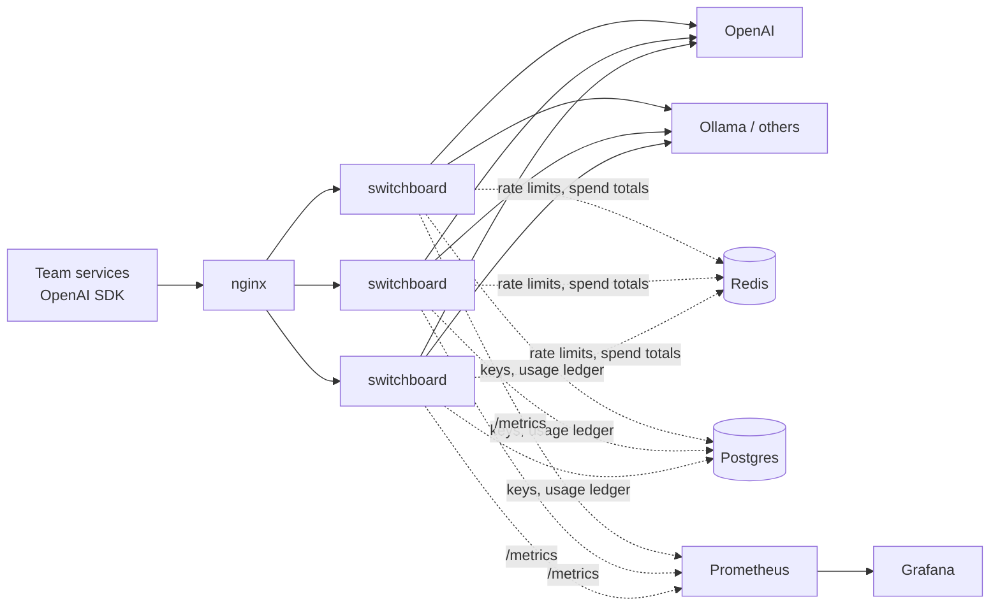

# switchboard

An LLM gateway: one OpenAI-compatible endpoint that sits between your teams and the model providers.

Teams point their existing OpenAI SDK at switchboard by changing `base_url`, and nothing else. Behind that endpoint, switchboard decides which provider and model to call, falls back when a provider is down, stops calling a provider that keeps failing, and records what every request cost and how long it took.

I'm building this in public to learn how production LLM infrastructure works. Every design choice, with the alternatives I considered and why I picked one, is written down in [DECISIONS.md](DECISIONS.md).

## Why a gateway

Picture a company with about 20 teams all calling LLM APIs directly. Each team handles outages, retries, keys, and cost tracking on its own, usually badly. When OpenAI has a bad hour, every team finds out separately. Nobody can answer "what are we spending, and on what?"

A gateway gives you one place to solve these problems once:

- **Reliability:** if one provider goes down, requests move to another, and clients don't see errors.
- **Cost:** you can see token spend per model (and per team, once auth lands), with a target of cutting the bill by 30% through caching and cheaper routing.
- **Control:** one place for keys, rate limits, and budgets.

The target is under 20 ms of added latency per request, at 50 requests per second on average and 300 at peak.

## Architecture



The gateway copies are stateless, so you can add or remove them freely. Anything that has to be shared between them (rate-limit counters, budgets, the cache) will live in Redis.

Each request goes through these steps, in this order:

```
auth -> rate limit -> budget -> cache -> router -> provider (with fallback + circuit breaker)
```

Rate limiting runs before the cache on purpose: otherwise one team spamming cached prompts could hog the gateway at everyone else's expense.

## What works today

**OpenAI-compatible API.** `POST /v1/chat/completions`, streaming or not. The official OpenAI SDK works unchanged, and fields the gateway doesn't model are passed through to the provider.

**Config-based routing.** `config.yaml` maps the names clients ask for to an ordered list of places to try:

```yaml
models:
  gpt-4o-mini:
    - provider: openai
      model: gpt-4o-mini
    - provider: ollama        # fallback
      model: llama3.2
  fast:                       # clients can ask for a tier instead of a vendor model
    - provider: openai
      model: gpt-4o-mini
```

**Several providers, one format.** Anything that speaks OpenAI's API (OpenAI, Groq, Ollama, vLLM) needs only a config entry. Anthropic speaks a different API, so `anthropic_adapter.py` translates the request on the way out and the response or stream on the way back. Clients never notice that their request was answered by Claude. Some details that come up when translating:

- Claude doesn't support some request features, like `tools`. When a request uses one, switchboard skips Claude and tries the next provider. This doesn't count against Claude's circuit breaker, since nothing is wrong with Claude.
- Current Claude models reject custom `temperature` and `top_p`, so switchboard drops them and names them in an `x-gateway-dropped-params` response header.
- Anthropic can return a 200 and then report "overloaded" inside the stream. switchboard holds the stream until the model starts its first content block, so it can still fall back if that happens.

Groq and Anthropic are wired up and tested against a fake Anthropic, but I haven't run them against the real APIs yet.

**Team API keys.** Each team gets its own `sbk_...` key and sends it the same way as an OpenAI key. Postgres stores only a SHA-256 hash of each key, so a leaked copy of the table can't be used to make requests. Each gateway copy caches lookups in memory (valid keys for 60 s, invalid ones for 10 s), so almost every request is checked without a database query. If Postgres is down, keys that aren't already cached are rejected rather than let through.

**Rate limits per team.** Each team has two token buckets in Redis, shared by every gateway copy: requests per minute and tokens per minute. Before calling a provider, the gateway takes a rough guess of the prompt's tokens; when the answer is done, it charges the real number from the provider's usage report. A team over its limit gets a 429 shaped like OpenAI's, with `Retry-After`, so the OpenAI SDK waits and retries on its own. If Redis goes down, requests keep flowing: each gateway copy enforces its share of the limit by itself until Redis is back.

**Monthly budgets per team.** Every request is priced by the model that actually answered: input, cached input, cache writes and output each at their own price, from a table in `config.yaml`. Money is kept as whole micro-dollars, never floats. Each request is written to an append-only ledger in Postgres, and Redis keeps a running total per team so the check before each request is a single lookup. A team past its `soft_usd` gets a warning and an alert; at `max_usd` its requests get a 429 until the month resets. If Redis is down, the check is skipped, but spending is still recorded.

**Fallback and retries.** The rule is to fall back only when the problem is the provider's, never the client's:

| What happened | What switchboard does |
|---|---|
| 400 (bad request) | Return it as is. Another provider can't fix a broken request. |
| 401/403 (our provider key is broken) | Try the next provider |
| 429 (rate limited) | Try the next provider. If none are left, return 503 with `Retry-After`. |
| 5xx or connection error | Try the next provider. On the last one, retry once with jitter. |
| Read timeout | Never retry, because the provider is already overloaded. Return 504. |

Clients can opt out of fallback with the `x-gateway-fallback: off` header.

**Streaming with a commit point.** For streams, the gateway reads ahead until the provider sends its first chunk, and only then sends `200` to the client. Before that point it can still fall back silently. After it, it can't, because the client already has part of the answer. If a provider dies mid-stream, the client gets an error event instead of an answer that just stops.

**Circuit breaker.** One breaker per provider-and-model pair. After 5 failures in a row it opens, and the gateway skips that model completely. After 30 seconds it lets exactly one trial request through to see whether the model has recovered. In a test with a broken provider key, failing requests took 0.3–0.75 s each before the breaker opened, and about 1.3 ms once it was open.

**Metrics.** A Prometheus endpoint at `/metrics`, plus two Grafana dashboards:

- **On-call:** request rate, error rate, and p50/p95 latency; then fallbacks, attempts per provider, open breakers, in-flight requests, time to first token (TTFT), and time per output token (TPOT).
- **Cost and usage:** tokens per model, plus spend and budget used per team. Prometheus alerts at 80% and 100% of a team's soft budget.

Alerts are based on TTFT and TPOT rather than total latency. Total latency mostly reflects how long the answer was, so a jump might just mean someone asked for longer answers. TTFT and TPOT only go up when the provider itself gets slower.

## Running it

You need Docker and an OpenAI API key. Python 3.9 or newer is only needed for the scripts and tests.

```bash
cp .env.example .env                  # then add your OPENAI_API_KEY
docker compose up -d --build          # 3 gateway copies behind nginx on :8000, plus Postgres, Redis,
                                      # Prometheus :9090 and Grafana :3000

python3 -m venv .venv
.venv/bin/pip install -r requirements-dev.txt
.venv/bin/python scripts/keys.py create my-team "laptop"   # prints a key once
export SWITCHBOARD_API_KEY=sbk_...                        # the key it printed

.venv/bin/python scripts/sdk_check.py     # one request through the OpenAI SDK
.venv/bin/python scripts/stream_check.py  # a streamed request, with client-side TTFT
```

Then open Grafana at http://localhost:3000 and go to Dashboards > Gateway: on-call.

`docker compose up` first runs a one-off `db-setup` container that creates the tables and a `gateway` database user. The gateway copies log in as that user, which can read keys and add usage rows but can't create keys, edit spend, or change tables. `scripts/keys.py` runs on your machine as the database owner.

To run a single gateway outside Docker while developing, keep the other services running, run `scripts/setup_db.py` once, and start `.venv/bin/uvicorn main:app --port 8001`.

Tests mock every provider, the key store and Redis, so they don't need a key, Postgres, Redis, or a network connection:

```bash
.venv/bin/python -m pytest -q
```

## Roadmap

- [x] Phase 0: passthrough proxy
- [x] Phase 1: streaming (SSE), TTFT, usage tracking
- [x] Phase 2: config routing, fallback, retries, circuit breaker, metrics
- [x] Phase 3: per-team API keys, rate limits, budgets, and everything running in Docker
- [ ] Phase 4: exact and semantic caching
- [ ] Phase 5: cascade routing (try a cheap model first, escalate when needed)
- [ ] Phase 6: mock provider, load tests with Locust, published numbers

## Docs

- [DESIGN.md](DESIGN.md): the problem, requirements, estimates, and architecture
- [DECISIONS.md](DECISIONS.md): every decision, with the alternatives, trade-offs, and further reading
- [PROJECT.md](PROJECT.md): the original spec
