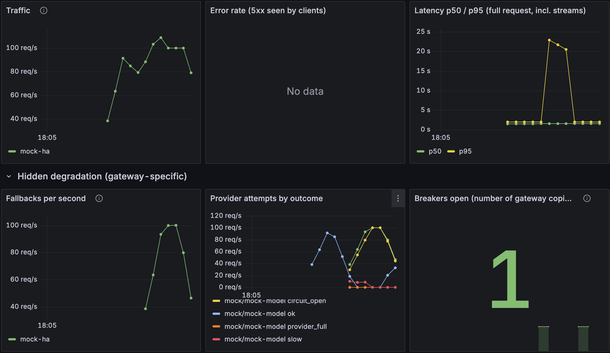

# switchboard

[](https://github.com/YashrajKupekar17/switchboard/actions/workflows/tests.yml)

An LLM gateway. One OpenAI-compatible endpoint between your teams and the model providers.

Teams keep using the OpenAI SDK and change only `base_url`. switchboard picks the provider, falls back when one fails, enforces each team's rate limits and budget, caches answers, and records what every request cost.


## What it does

- **Routing and fallback.** `config.yaml` maps a model name to an ordered list of providers. Provider problems (5xx, 429, timeouts) move the request to the next one; client errors (400) are returned as they are.
- **Circuit breakers.** After 5 failures in a row a model is skipped for 30 s, then one trial request checks whether it's back.
- **Streaming.** The gateway waits for the provider's first chunk before sending `200`, so it can still fall back until the answer starts.
- **Several providers, one format.** OpenAI, Groq and Ollama by config; Anthropic through an adapter that translates requests and streams both ways.
- **Team keys, limits and budgets.** Hashed API keys, per-team and per-key rate limits in Redis, monthly budgets from an append-only Postgres ledger. Keys can expire, be rotated with a grace period, and every change is audited.
- **Caching.** An exact cache, and a semantic cache where an embedding finds a similar past question and an LLM decides whether it really is the same question.
- **Metrics.** Prometheus and two Grafana dashboards: one for on-call (errors, latency, TTFT, breakers), one for cost per team and model.

## Numbers

All measured on a laptop against a mock provider or a replayed dataset. The method behind each is in [DECISIONS.md](DECISIONS.md).

**Load** (one gateway copy, one CPU, added latency over the provider):

| Traffic | Requests/s | p50 | p99 |
|---|---|---|---|
| Non-streamed | 500 | +5 ms | +308 ms |
| Streamed, first token | 200 | +9 ms | +245 ms |
| Exact cache hits | 800 | 1 ms total | 160 ms total |

Profiling showed httpx's connection pool spending 88% of the CPU on bookkeeping. Moving provider calls onto aiohttp tripled throughput. Past capacity, the gateway sheds load with a fast 503 instead of slowing down for everyone.

**Provider outage** (100 requests/s, first-choice provider broken for a minute):

| How it broke | Requests that succeeded |
|---|---|
| Container killed | 100% |
| Every request a 500 | 100% |
| 20 s per answer | 100% (60% before the fix) |

The slow provider was the hard one. Its answers counted as successes, held connections twenty times longer, and took the whole pool. The fix was a per-provider connection cap and a breaker that counts slow answers as failures.



**Semantic cache** (1,000 customer-support questions replayed through gpt-4o-mini): 57% answered from the cache, **38% lower cost** after paying for the embedding and judge calls. 4.2% of cache hits answered a slightly different question, so it suits FAQs, not questions about a specific order or account.

## Running it

You need Docker and an OpenAI API key.

```bash
cp .env.example .env                  # add your OPENAI_API_KEY
docker compose up -d --build          # gateway x3 on :8000, Postgres, Redis, Prometheus :9090, Grafana :3000

python3 -m venv .venv && .venv/bin/pip install -r requirements-dev.txt
.venv/bin/python scripts/keys.py create my-team "laptop"   # prints a key once
export SWITCHBOARD_API_KEY=sbk_...
.venv/bin/python scripts/sdk_check.py
```

Then call it like OpenAI:

```python
import os
from openai import OpenAI
client = OpenAI(base_url="http://localhost:8000/v1", api_key=os.environ["SWITCHBOARD_API_KEY"])
client.chat.completions.create(model="gpt-4o-mini", messages=[{"role": "user", "content": "hi"}])
```

Tests mock every provider and service, so they need nothing running: `.venv/bin/python -m pytest -q`. Load and chaos tests: `loadtest/run.sh`, `loadtest/chaos.sh`.

## Docs

- [docs/USING.md](docs/USING.md): calling the gateway: models, headers, errors, limits, the cache
- [DESIGN.md](DESIGN.md): requirements, estimates, architecture
- [DECISIONS.md](DECISIONS.md): every design decision, with the alternatives and trade-offs
