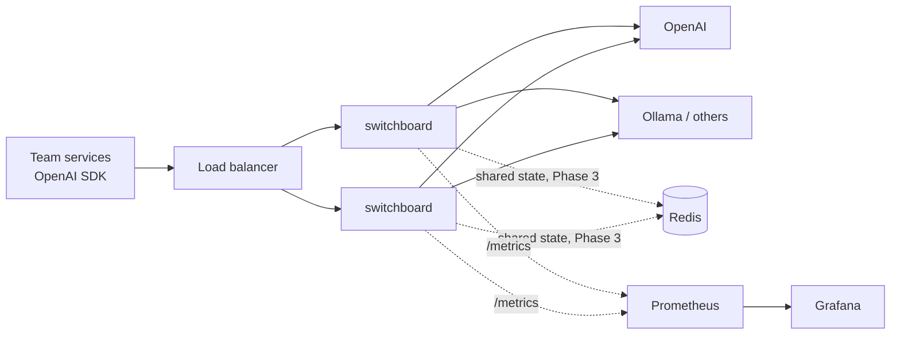

# switchboard

An LLM gateway: one OpenAI-compatible endpoint that sits between your teams and the model providers.

Teams point their existing OpenAI SDK at switchboard by changing `base_url`, and nothing else. Behind that endpoint, switchboard decides which provider and model to call, falls back when a provider is down, stops calling a provider that keeps failing, and records what every request cost and how long it took.

I'm building this in public to learn how production LLM infrastructure works. Every design choice, with the alternatives I considered and why I picked one, is written down in [DECISIONS.md](DECISIONS.md).

## Why a gateway

Picture a company with about 20 teams all calling LLM APIs directly. Each team handles outages, retries, keys, and cost tracking on its own, usually badly. When OpenAI has a bad hour, every team finds out separately. Nobody can answer "what are we spending, and on what?"

A gateway gives you one place to solve these problems once:

- **Reliability:** if one provider goes down, requests move to another, and clients don't see errors.
- **Cost:** you can see token spend per model (and per team, once auth lands), with a target of cutting the bill by 30% through caching and cheaper routing.
- **Control:** one place for keys, rate limits, and budgets.

The target is under 20 ms of added latency per request, at 50 requests per second on average and 300 at peak.

## Architecture



The gateway copies are stateless, so you can add or remove them freely. Anything that has to be shared between them (rate-limit counters, budgets, the cache) will live in Redis.

Each request goes through these steps, in this order:

```
auth -> rate limit -> cache -> router -> provider (with fallback + circuit breaker)
```

Rate limiting runs before the cache on purpose: otherwise one team spamming cached prompts could hog the gateway at everyone else's expense.

## What works today

**OpenAI-compatible API.** `POST /v1/chat/completions`, streaming or not. The official OpenAI SDK works unchanged, and fields the gateway doesn't model are passed through to the provider.

**Config-based routing.** `config.yaml` maps the names clients ask for to an ordered list of places to try:

```yaml
models:
  gpt-4o-mini:
    - provider: openai
      model: gpt-4o-mini
    - provider: ollama        # fallback
      model: llama3.2
  fast:                       # clients can ask for a tier instead of a vendor model
    - provider: openai
      model: gpt-4o-mini
```

**Fallback and retries.** The rule is to fall back only when the problem is the provider's, never the client's:

| What happened | What switchboard does |
|---|---|
| 400 (bad request) | Return it as is. Another provider can't fix a broken request. |
| 401/403 (our provider key is broken) | Try the next provider |
| 429 (rate limited) | Try the next provider. If none are left, return 503 with `Retry-After`. |
| 5xx or connection error | Try the next provider. On the last one, retry once with jitter. |
| Read timeout | Never retry, because the provider is already overloaded. Return 504. |

Clients can opt out of fallback with the `x-gateway-fallback: off` header.

**Streaming with a commit point.** For streams, the gateway reads ahead until the provider sends its first chunk, and only then sends `200` to the client. Before that point it can still fall back silently. After it, it can't, because the client already has part of the answer. If a provider dies mid-stream, the client gets an error event instead of an answer that just stops.

**Circuit breaker.** One breaker per provider-and-model pair. After 5 failures in a row it opens, and the gateway skips that model completely. After 30 seconds it lets exactly one trial request through to see whether the model has recovered. In a test with a broken provider key, failing requests took 0.3–0.75 s each before the breaker opened, and about 1.3 ms once it was open.

**Metrics.** A Prometheus endpoint at `/metrics`, plus two Grafana dashboards:

- **On-call:** request rate, error rate, and p50/p95 latency; then fallbacks, attempts per provider, open breakers, in-flight requests, time to first token (TTFT), and time per output token (TPOT).
- **Cost and usage:** tokens per model.

Alerts are based on TTFT and TPOT rather than total latency. Total latency mostly reflects how long the answer was, so a jump might just mean someone asked for longer answers. TTFT and TPOT only go up when the provider itself gets slower.

## Running it

You need Python 3.9 or newer, Docker, and an OpenAI API key.

```bash
python3 -m venv .venv
.venv/bin/pip install -r requirements-dev.txt
echo "OPENAI_API_KEY=sk-..." > .env

.venv/bin/uvicorn main:app            # gateway on :8000
docker compose up -d                  # Prometheus on :9090, Grafana on :3000

.venv/bin/python scripts/sdk_check.py     # one request through the OpenAI SDK
.venv/bin/python scripts/stream_check.py  # a streamed request, with client-side TTFT
```

Then open Grafana at http://localhost:3000 and go to Dashboards > Gateway: on-call.

Tests mock every provider, so they don't need a key or a network connection:

```bash
.venv/bin/python -m pytest -q
```

## Roadmap

- [x] Phase 0: passthrough proxy
- [x] Phase 1: streaming (SSE), TTFT, usage tracking
- [x] Phase 2: config routing, fallback, retries, circuit breaker, metrics
- [ ] Phase 3: per-team API keys, rate limits, and budgets in Redis; everything runs in Docker
- [ ] Phase 4: exact and semantic caching
- [ ] Phase 5: cascade routing (try a cheap model first, escalate when needed)
- [ ] Phase 6: mock provider, load tests with Locust, published numbers

## Docs

- [DESIGN.md](DESIGN.md): the problem, requirements, estimates, and architecture
- [DECISIONS.md](DECISIONS.md): every decision, with the alternatives, trade-offs, and further reading
- [PROJECT.md](PROJECT.md): the original spec
